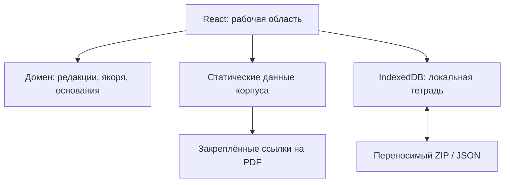

# Архитектура этапа 0.1

## Назначение и граница реализации

Этап 0.1 реализует индивидуальную исследовательскую работу с программами и карточками практик. Его основной результат — сохранённая связь между конкретным полем практики, точным фрагментом документа и неизменяемой редакцией этого документа. Эта связь может быть положительной, частичной или фиксировать противоречие.

Клиент работает в браузере; результаты хранятся локально. Поставляемый Node-сервер раздаёт готовые статические файлы и не является сервером пользовательских данных. На этом этапе нет Supabase-проекта, серверных сессий, аутентификации, синхронизации результатов между устройствами или анонимного исследовательского опроса. Полное видение образовательной платформы сохранено в `docs/spec`; планы дальнейших этапов приведены в конце этого документа.



Переход к PDF выполняется по внешней ссылке. Приложение не получает пользовательскую тетрадь обратно через HTTP и не передаёт её содержимое в сторонний сервис.

## Слои и ответственность

| Слой | Реализация | Ответственность |
| --- | --- | --- |
| Интерфейс | `apps/web/src/App.tsx`, `components` | Библиотека, читатель, поиск, выбор фрагментов, карточки, инспектор полей, рабочая тетрадь |
| Загрузка корпуса | `apps/web/src/lib/corpus.ts` | Паспорт источника, загрузка конкретной версии, доменная валидация и небольшой кеш документов |
| Каталог мер | `apps/web/src/lib/family-catalog.ts` | Ленивое чтение полного справочника, строгая территориальная привязка, сохранение происхождения и исходных полей |
| Поиск и выделение | `lib/search.worker.ts`, `lib/selection.ts`, соответствующие hooks | Поиск в отдельном worker, перевод DOM-позиций в канонические диапазоны |
| Предметный контракт | `packages/domain` | Версии документов, Unicode-позиции, точные якоря, оценка основания каждого поля |
| Локальное состояние | `apps/web/src/storage`, `hooks/useWorkspace.ts` | IndexedDB, транзакции, ревизии, идемпотентность операций и уведомления вкладок |
| Обмен | `lib/archive.ts`, `storage/exchange.ts` | ZIP/JSON, проверка входных данных, сохранение происхождения импортированных решений |
| Подготовка данных | `scripts/ingest` | Зафиксированный checkout, проверка SHA-256, извлечение текста, каноническая идентичность и точные связи |
| Локальная доставка | `scripts/serve.mjs` | Только стандартная библиотека Node.js, `dist` и разрешённый fallback к данным |

Внешний каталог не импортируется в JavaScript-бандл. Новый пользователь получает небольшой манифест, подготовленные варианты и один выбранный документ. Полный справочник запрашивается отдельным действием либо для восстановления уже сохранённых ссылок на его карточки. Читатель выводит страницу и при необходимости соседнюю страницу, а не весь документ в DOM одновременно.

## Канонический документ и воспроизводимая цитата

`DocumentMeta` описывает источник. `DocumentVersion` задаёт конкретное представление конкретной редакции: упорядоченные блоки, файловые страницы, нормализацию и SHA-256 исходного PDF. В JSON хранится одна коллекция `version.blocks`; страницы ссылаются на идентификаторы блоков.

Текст получен Poppler в режиме `pdftotext -layout -enc UTF-8`. Нормализация `unicode-nfc-lf-v1` означает только NFC и переводы строк LF. Пробелы внутри блоков сохраняются. Разбиение по пустым строкам фиксируется версией сегментатора. Автоматическое восстановление таблиц, OCR и исправление переносов слов в этот импорт не входят.

Идентификатор версии имеет форму:

```text
{documentId}@layout-canonical-v2-{sourceSha256prefix12}-{canonicalHashprefix12}
```

Полный `canonicalHash` включает версии представления, нормализатора и сегментатора, текст и границы каждого блока, порядок блоков и распределение по страницам. Новое извлечение не может сохранить прежний ID, если изменились текст, разбиение или постраничная структура. Время повторного импорта не влияет на идентичность. `textHash` сквозного текста хранится отдельно.

`TextAnchor` содержит один или несколько `spans`. У каждого есть `blockId`, `start`, `end`, `exact`, `prefix` и `suffix`; конец диапазона не включается. Позиции измеряются в Unicode code points. Индексы DOM, измеряемые в UTF-16, переводятся через доменные функции. Возврат к цитате включает проверку редакции и буквального совпадения фрагментов; другой текст под прежним ID не принимается.

Полнота исходного файла и состояние извлечения независимы. Из 80 извлечений 79 готовы к чтению, одно требует проверки пустых страниц. При этом три исходных файла уже были частичными. Метка «проверен фрагмент» не означает, что весь документ прочитан или прошёл экспертизу.

## Модель практик и доказательств

| Сущность | Смысл |
| --- | --- |
| `PracticeFamily` | Обобщённый механизм, к которому могут относиться разные региональные реализации |
| `PracticeVariant` | Самостоятельный вариант с собственными получателями, размером и условиями |
| `PracticeOccurrence` | Указание на точный фрагмент определённой версии документа |
| `FieldEvidence` | Отношение фрагмента к конкретному полю: подтверждение, частичное подтверждение или противоречие |
| `reviewedValue` | Значение поля в момент проверки; изменение поля делает прежнюю проверку недостаточной |

Подготовленные 15 вариантов имеют 56 связей с точными фрагментами. Буквальное совпадение всех фрагментов проверено программно, но их исходный статус остаётся `candidate`: фактическую содержательную проверку выполняет человек. Цитата, относящаяся к механизму, сама по себе не подтверждает сумму или критерий получения.

Полный справочник содержит 2 274 отдельные карточки. Адаптер сохраняет `catalogId`, исходный `snapshot` и `provenance`; категории справочника не используются как автоматические семейства механизмов. `familyId: external-catalog` обозначает временную несгруппированную коллекцию. У внешних карточек первоначально нет `evidence` и `occurrenceIds`. Поля получателей и условий заполняются только из явно структурированных полей; в текущем справочнике таких полей нет. Примечания остаются примечаниями.

111 федеральных карточек сохраняют `regionId: federal`. Для применения в региональном документе требуется самостоятельный вариант соответствующего региона. Региональные карточки сопоставляются только по проверенному словарю `territory` манифеста после ограниченной типографской нормализации. Неизвестное или неоднозначное название не получает случайный регион.

Восемь подготовленных вариантов связаны с исходными карточками по `catalogId`. Оба объекта продолжают существовать отдельно: различающиеся размеры, расчётные базы и временные условия не объединяются. Например, предложение из программы одного года и выплата из более позднего справочника являются разными утверждениями источников; их расхождение требует интерпретации, а не автоматического выбора «верной» суммы.

## Локальная тетрадь и конкурирующие изменения

База `demography-workshop-local-v1` использует хранилища тетрадей, операций и редакций источников. Основное состояние включает локальный профиль, ссылки на редакции, точные выделения, предложения практик, решения по связям, авторские карточки и задачи чтения. Успешное сохранение означает завершённую транзакцию IndexedDB.

Запись содержит ожидаемую ревизию. Если другая вкладка уже изменила тетрадь, операция получает конфликт и актуальное состояние. Повтор операции с тем же `operationId` и содержимым возвращает квитанцию; использование того же ID для другой операции отклоняется. Состояние и квитанция записываются атомарно. BroadcastChannel передаёт уведомление об изменении, но источником истины остаётся IndexedDB.

ФИО и email являются необязательным локальным профилем. Владение email не проверяется. Один origin и один профиль браузера используют одну локальную тетрадь; разные пути того же сайта не создают независимые серверные занятия. Переход между HTTP/HTTPS, доменами или портами меняет origin и, соответственно, доступное браузеру хранилище.

## Переносимость и проверка импорта

Интерфейс экспортирует ZIP с `workspace.json` и краткой инструкцией. Локальный профиль исключается. Текст заметок и цитат сохраняется без автоматического удаления персональных сведений, если пользователь сам ввёл их в эти поля. Формат обмена имеет версию схемы; содержимое JSON ограничено 5 МиБ, входной файл — 8 МиБ.

Импорт проверяет структуру, размеры, идентификаторы, ссылки, редакции и допустимые значения до сохранения. Существующая цитата или редакция не заменяется другим содержимым под тем же идентификатором. Новые сущности добавляются к локальной работе. Положительные отметки импортированной проверки переводятся в кандидаты для повторной оценки, а происхождение сохраняется. JSON и ZIP не являются электронной подписью и не удостоверяют автора.

## Статический сервер и размещение

`node scripts/serve.mjs` работает на Node.js 22.12+ без npm-пакетов. Сервер слушает только `127.0.0.1`, по умолчанию порт 4173; `PORT` меняет порт. Он отдаёт `dist/index.html`, разрешённые типы ресурсов в `dist/assets`, JSON/GeoJSON по маршруту `/data` и явный набор значков. Для `/data` сначала используется `dist/data`, затем `public/data`; значки также имеют ограниченный fallback к `public`. Остальные каталоги проекта не публикуются.

Путь декодируется один раз с проверкой ошибок. Запрещены dotfiles, сегменты выхода из каталога, остаточное двойное кодирование, неподдерживаемые пути и доступ через симлинк за границы разрешённого дерева. Исходники TypeScript, source maps, конфигурация и npm-зависимости не раздаются. GET и HEAD — единственные разрешённые методы; обработчика записи данных нет. Неизвестный JSON-адрес возвращает 404, а не HTML приложения.

Для текстовых ресурсов выполняется gzip по запросу клиента. Кеш сжатых объектов ограничен 8 МиБ и 24 записями; одновременно буферизуется не более четырёх файлов до 4 МиБ каждый. Более крупные файлы и запросы сверх этого лимита проходят потоковое сжатие. ETag различает представления gzip/identity и учитывает метаданные файла; изменение файла не оставляет прежний сжатый ответ актуальным. Сервер поддерживает HEAD и условный ответ 304.

CSP разрешает скрипты, worker и соединения только с тем же origin. Для React-атрибутов `style` требуется `style-src 'self' 'unsafe-inline'`; это разрешение не распространяется на скрипты. Встраивание ограничено тем же origin. Дополнительно устанавливаются `nosniff`, запрет передачи referrer и ограничение доступа к ресурсам тем же origin. Внешние PDF и страницы каталога открываются как ссылки и не требуют разрешения внешних скриптов.

Для телефонов используется статическое HTTPS-размещение полного дерева опубликованных файлов. Loopback-сервер не предоставляет доступ с другого устройства. При размещении комплект без `dist/data` необходимо дополнить каталогом `data` из `public/data`. HTML-fallback для отсутствующих JSON и внешние CDN для основных ресурсов этой версии не требуются.

## Воспроизводимость и подтверждённые проверки

Исходный `family-support` закреплён коммитом `5dde46ae663b7652a448ec982585e64d61a26a61`. Импорт проверяет SHA-256 PDF и неизменность исходных метаданных. Подробный реестр — в `docs/data-catalog.md` и `reuse-manifest.json`. PDF не входят в релиз; закреплённые URL позволяют открыть соответствующие оригиналы через интернет.

Доменный пакет, локальное хранение и адаптеры покрываются Vitest. Отдельный `tests/server.test.mjs` запускает копию сервера в временном комплекте без `node_modules` и проверяет HTTP-поведение стандартной библиотекой Node в одном сетевом пространстве. В выполненном прогоне все шесть сценариев и общий тест прошли — 7 pass. Это проверка доставки файлов, а не подтверждение приёмки всех браузерных сценариев. Фактический итог интеграционной и браузерной проверки выпуска приведён в `docs/release-qa.md`; исходные сценарии приёмки — в `docs/stage-01-acceptance.md`.

## Последующие этапы: проектные цели, не реализованные возможности 0.1

Единый реестр реализованного объёма и последовательности развития — `docs/implementation-status.md`. Ниже зафиксированы архитектурные условия перехода к следующим этапам из этого реестра.

| Этап | Архитектурное условие реализации |
| --- | --- |
| 2. Учебные сессии и синхронизация | Подтверждение email, роли, модель области занятия, изоляция сессий и RLS, миграции, конкурентное редактирование и проекторный режим проверяются до коллективного оценивания. Конфигурация Supabase и размещение выбираются до загрузки персональных данных. |
| 3. Карта работы и коллективная экспертиза | Работа с регионами, объединение семейств и голосование сохраняют конкретные варианты, редакции, решения экспертов и журнал происхождения; текстовое сходство само по себе не объединяет условия. |
| 4. Путь родительства и барьеры | Исследовательский анонимный опрос отделяется от именных учебных результатов; проверяются согласие, свойства анонимности, обсуждение, сенсорное управление и сопоставление проблем с практиками. |
| 5. Муниципальные дорожные карты | Одна общая карта на муниципалитет в рамках занятия; версии территорий и статистики, БДМО, сравнения, сценарии, действия, сроки, бюджет и DOCX/PDF проверяются сквозным сценарием двух семинаров и двух практикумов. |

Существующие цитаты, источники и варианты должны мигрировать между этапами без потери редакций и происхождения. Предложение целевой траектории показателя в будущем модуле не должно автоматически трактоваться как доказанный причинный эффект выбранной меры.
