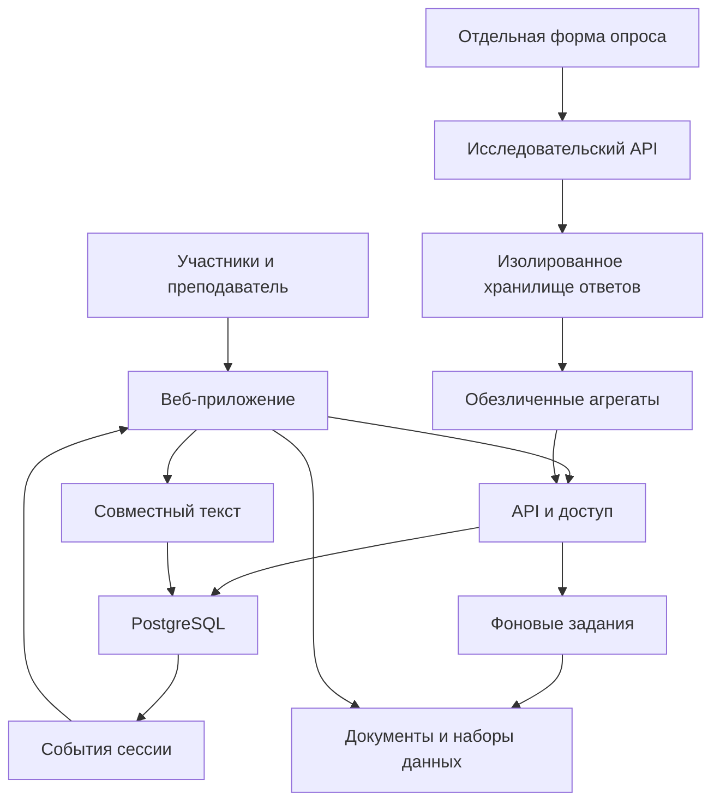

# Техническое задание на универсальную платформу совместной разработки демографических программ

## 0. Назначение документа и границы разработки

Версия 1.0. Дата фиксации требований и проверки внешних источников: 8 ноября 2026 года. Заказчик и научный руководитель: Арсений Михайлович Ситковский. Рабочее название продукта: «Демографическая мастерская». Окончательное название задаётся конфигурацией бренда. Документ предназначен для размещения в репозитории будущего приложения и последовательной реализации в Codex App.

Платформа обеспечивает очную коллективную работу над демографическими проблемами, региональными практиками и территориальными дорожными картами. Первый сценарий — четыре занятия по 90 минут для муниципальных служащих и представителей учреждений Республики Мордовия. Архитектура и информационная модель с первой версии поддерживают муниципальный, региональный, федеральный и организационный уровни. Преподаватель выбирает территорию, масштаб работы, состав участников, материалы, длительность этапов и правила обсуждения.

Главный продукт занятия — одна совместная дорожная карта на выбранную территорию в пределах учебной сессии, с прослеживаемой связью между проблемой, источниками, решениями, мероприятиями, показателями, финансированием и ответственностью. Индивидуальный вклад сохраняется внутри коллективной работы. Исследовательские ответы о личных репродуктивных намерениях хранятся отдельно и не становятся частью индивидуального учебного профиля.

Настоящее задание описывает разработку продукта. Наличие требования не означает, что соответствующая функция или набор данных уже реализованы. Исходные платформы используются как проверенные референсы и источники материалов; их рабочие версии не изменяются в рамках нового проекта. Создание репозитория, развёртывание сервисов и реализация приложения выполняются отдельным этапом после принятия архитектуры.

### 0.1. Принципы принятия решений

| Код | Обязательный принцип | Проверяемое следствие |
|---|---|---|
| CORE-01 | Центральный интерфейс — совместное рабочее пространство | Главный экран открывает текущую сцену занятия; набор сводных KPI не заменяет рабочую сцену |
| CORE-02 | Любое содержательное заимствование имеет источник | Из карточки практики доступны редакция документа, страница, фрагмент и обратный переход |
| CORE-03 | Гипотезы, факты, оценки участников и расчёты различаются | Каждый показатель и вывод содержит соответствующий статус; одинаковое оформление не маскирует различия |
| CORE-04 | Доступ с телефона полноценный | Все содержательные действия доступны без мыши; у перетаскивания есть кнопочная альтернатива |
| CORE-05 | Сбой связи не уничтожает работу | Локальный черновик, подтверждение серверного сохранения, повторная доставка и разрешение конфликтов предусмотрены явно |
| CORE-06 | Повторные отправки не создают дубли | Команды записи имеют ключ идемпотентности, голоса и дорожные карты защищены ограничениями уникальности |
| CORE-07 | Преподаватель управляет темпом, участники — содержанием | Ведущий открывает этапы и модерирует; решение и его обоснование создают участники |
| CORE-08 | Научная корректность встроена в вычисления | Пользовательская целевая траектория не получает подпись «доказанный эффект меры» |
| CORE-09 | Участие в исследовательском опросе добровольное | Пропуск опроса не ограничивает занятие, не уменьшает результат и не отображается в именном рейтинге |
| CORE-10 | Универсальность достигается конфигурацией | Мордовия, названия учреждений, территориальные коды и годы не зашиваются в компоненты |

Слова «должен», «обязательно» и требования с кодами обозначают условия приёмки. Числовые показатели производительности ниже являются целевыми характеристиками проекта, подлежащими измерению. Оценки трудоёмкости занятия обозначают проектные предположения. Данные из внешних источников имеют самостоятельную дату актуальности.

## 1. Результаты и модель использования

### 1.1. Результаты для участников и преподавателя

К завершению занятия участник получает персональную страницу своих именных вкладов: предложенные профессиональные проблемы, выделенные фрагменты документов, проверенные карточки практик, аргументы, рецензии и участие в общей дорожной карте. Преподаватель получает карту работы группы, результаты голосований, документальные основания выбранных решений, сопоставимые дорожные карты и экспорт учебных результатов. Персональная страница не содержит анонимных ответов и не позволяет установить факт ответа на отдельный чувствительный вопрос.

Команда получает дорожную карту в DOCX и PDF, машиночитаемый архив проекта, графики с источниками и расчётную записку. При необходимости документ экспортируется в структуре организаторского шаблона. Дополнительные разделы расширенной версии оформляются приложениями, чтобы сохранить совместимость с ожидаемым форматом.

Исследователь получает отдельный обезличенный массив открытых ответов, кодировочную книгу, параметры учебной выборки, формулировки вопросов и версию процедуры. Материал характеризуется как исследование участников конкретной образовательной сессии. Общероссийская или региональная репрезентативность из состава слушателей не следует.

### 1.2. Режимы территориальной работы

| Режим сессии | Основная единица команды | Итоговый документ | Особенность аналитики |
|---|---|---|---|
| Муниципальный | Муниципальное образование выбранного субъекта | Одна дорожная карта на муниципалитет | Местные временные ряды, сравнение сопоставимых муниципалитетов, полномочия местного уровня |
| Региональный | Субъект РФ | Одна региональная дорожная карта | Внутрирегиональные различия, муниципальное распределение ресурсов, региональные полномочия |
| Федеральный | Страна; группы могут вести разделы или направления общего документа | Сводный документ приоритетов и мероприятий | Сравнение субъектов, федеральные инструменты и межбюджетные механизмы |
| Организационный | Учреждение или организация, связанная с территорией | Дорожная карта организации | Работники, получатели услуг, локальные ресурсы; территориальная демография служит контекстом |

Уровень управления и территория — отдельные поля. Федеральный служащий может анализировать конкретный регион, а сотрудник регионального учреждения — участвовать в муниципальной команде. Нельзя выводить права доступа из названия должности или выбранной территории.

### 1.3. Масштаб и целевые условия

Основная приёмочная нагрузка — 100 активных участников одной сессии плюс преподаватели, наблюдатели и проектор. Проверка масштабирования — 500 активных участников в пяти параллельных сессиях, с запасом на несколько устройств и вкладок. Планирование соединений выполняется раздельно: до 700 соединений Supabase Realtime и до 700 соединений collab, то есть до 1 400 WebSocket на reverse proxy при одновременном максимуме. Это запас соединений, не утверждение о 700 активных авторах каждого типа. Подписки одной вкладки мультиплексируются, где это поддерживается выбранным SDK; дополнительные соединения включаются в измеренный бюджет. Профили нагрузки определены в разделе 25.

Первый содержательный запуск полностью комплектуется для Мордовии. В той же версии работоспособность универсальной модели проверяется ещё на двух субъектах с отличающимся муниципальным устройством и на федеральной сессии. Общероссийские справочники, имеющийся корпус программ и доступные муниципальные данные импортируются в общую модель; подробная геометрия и статистика загружаются на устройство по запросу.

## 2. Проверенные исходные наработки

### 2.1. Снимки источников

| Источник | Проверенный снимок | Что имеется | Что необходимо разработать |
|---|---|---|---|
| RUDN | `08c68f1fe1c812ed059b0b124b25c26c6fdd374f` | Читалка Семинара 4, структурные выделения, поиск, ограниченное присутствие, локальные черновики, муниципальные полигоны в модуле пазла | Новые предметные сущности, Supabase, точные цитаты, общая доска и дорожные карты |
| family-support | `5dde46ae663b7652a448ec982585e64d61a26a61` | Дизайн-токены, региональная карта, каталог мер, файлы программ и паспорта | Полнотекстовый индекс программ, связи фрагментов с мерами, дедупликация, импорт муниципальных геометрий RUDN и соответствия кодам |
| Settlements-projection-dashboard | `59b778760c9efa6fe30d6ad17beec6ea622f30b5` | Муниципальные компоненты, возрастные профили, фактические и расчётные ряды, Parquet | Проверенный адаптер; полное происхождение отдельных полей; подключение полного пользовательского корпуса БДМО |
| Шаблон организаторов | DOCX, SHA-256 `2517b1f7d7cde99890f6abca5b9f009d247899cc96b1c6627bd5e1663c70f71e` | Паспорт, диагностика, показатели, мероприятия, этапы, ресурсы, риски, мониторинг | Интерактивное представление, расширение содержательных связей и точный экспорт |

Проверка выполнена по исходному коду и включённым данным. Доступность действующих серверов, реальные серверные правила Firebase и поведение production-сайтов не были предметом этой инвентаризации. Перед переносом Codex фиксирует актуальный commit, изменения относительно указанных снимков и файл `reuse-manifest.json`. [S01–S04]

### 2.2. Переносимые механизмы RUDN

| Файлы | Сохраняемый принцип | Граница переноса |
|---|---|---|
| `site/apps/legal-lab/lib/reader-view.mjs`, `reader-tools.mjs` | Оглавление, поиск, выбор структурных единиц | Сейчас выбор производится по абзацам; произвольный диапазон требует нового слоя |
| `reader-controller.mjs`, `reader-data.mjs`, `scripts/build_legal_lab_reader.mjs` | Производный корпус, манифест, загрузка окна текста и поиск в Worker | Новые типы таблиц и страниц региональных программ проверяются отдельно |
| `site/apps/legal-lab/lib/live.mjs` | Ограниченный presence, обновления по семантическому изменению | Временное присутствие не заменяет постоянную аннотацию и журнал вклада |
| `site/assets/js/durable-store.js`, `checkpoint-sync.js` | Черновики, очередь, ревизии и повторная доставка | Firebase-транспорт и идентификаторы учебного курса заменяются |
| `site/assets/js/backend.js`, `main.js` | Быстрый двухшаговый вход | Заявленный email не превращается в подтверждённую идентичность |

Для нового reader полезен существующий подход: ограниченное число абзацев в DOM, небольшой LRU-кэш и полнотекстовый поиск в Web Worker. Конкретные лимиты заново измеряются на региональных программах. Копирование целого приложения с прежними коллекциями Firebase, оценками курса и studentKey не допускается.

Механизм RUDN `mergeCheckpoint` сохраняет конфликтующие ветви одного владельца и не является CRDT для нескольких соавторов общей дорожной карты. Из него переносятся принципы идемпотентности и сохранения конфликтов; многопользовательский текст и структурированные команды реализуются по отдельным контрактам разделов 20–22.

### 2.3. Корпус программ и пределы его полноты

В проверенном `strategies.json` содержится 136 паспортов различных типов. Фильтр `group=regional` даёт 89 записей региональных программ: 77 полных материалов, 3 частичных, 4 файла со статусом недоступности и 5 отсутствующих материалов. Доступные региональные материалы занимают 6 340 страниц и около 380 МБ. Фильтрация по `scope=regional` даёт другое число, поскольку включает дополнительные нормативные документы. [S02]

Каталог мер содержит 2 274 технические карточки. Количество карточек не является количеством независимо проверенных действующих мер. Каталог и корпус программ имеют разное происхождение; совпадение названий не устанавливает юридическую тождественность.

Мордовская программа в исходном корпусе — 137 страниц, редакция от 19 декабря 2024 года. Её актуальность проверяется до формирования учебного релиза. На момент подготовки настоящего ТЗ не следует считать такую редакцию автоматически действующей на дату будущего занятия.

Частичные материалы представлены для Вологодской области, Марий Эл и Челябинской области. Недоступные файлы отмечены для Волгоградской области, Камчатского края, Москвы и Ненецкого АО. Отсутствующие материалы отмечены для Республики Алтай, ДНР, ЛНР, Запорожской и Херсонской областей. Статус отражает состояние поставки. Вывод об отсутствии программы на территории по нему не формируется.

### 2.4. Геоданные и статистика

В `family-support/site/data/ru-regions.geojson` имеются 89 геометрий и внутренние идентификаторы вида `ru_region:<hash>`. Официальные коды ОКТМО/ОКАТО в них отсутствуют. `site/lib/russia-map-projection.js` содержит картографическую проекцию, пригодную для национальной обзорной сцены. Перенос требует явного соответствия геометрии, официального территориального справочника и документа.

В отдельном модуле пазла RUDN найден муниципальный каталог `site/assets/puzzle/data/municipal/catalog.json` с 2 381 единицей в 89 субъектах и файлами `subject-*.geojson`. Мордовия представлена 23 полигонами в `subject-72196.geojson`. Исходный набор датирован 28 октября 2025 года, импорт — 31 августа 2026 года. Поля `id`, `subject_id`, `names_rosstat`, `source_gid` и `source_fid` требуют привязки к официальным кодам; ОКТМО отсутствует. Встроенные population/area/density не принимаются за актуальную статистику без отдельной проверки года и источника. Лицензия первичного объединённого набора нуждается в установлении. Отдельный модуль settlements содержит контур республики и населённые пункты; эти ресурсы не следует смешивать с муниципальными полигонами.

В `Settlements-projection-dashboard/data/config.json` указаны фактические компоненты рождаемости и смертности за 2008–2023 годы, миграции за 2010–2023 годы и расчётные сценарии до 2100 года. Метаданные содержат 2 367 муниципальных записей; число территориальных записей нельзя автоматически трактовать как актуальный справочник муниципалитетов. Полный пользовательский корпус БДМО требует отдельного подтверждения состава и подключения. Ранее рассчитанные траектории и реконструированные возрастные структуры получают признак модельного происхождения. [S03]

## 3. Содержательная модель и прослеживаемость

Платформа хранит происхождение решения как граф связанных объектов. У каждой связи есть автор или роль редактора, дата, пояснение и статус проверки. Пространственное расположение карточек не заменяет смысловую связь.

| Объект | Содержание | Ключевые связи |
|---|---|---|
| Жизненный этап | Условная стадия семейной ситуации | Несколько барьеров, переходы и возвраты |
| Барьер | Конкретное затруднение, целевая группа, территория и основание | Этапы, наблюдения, статистика, практики |
| Источник | НПА, программа, отчёт, статистический набор | Версии, фрагменты, показатели |
| Региональный вариант меры | Определённая мера в определённом регионе и редакции; статус исполнения хранится отдельно | Цитаты, условия, сроки, исполнитель, механизм |
| Семейство практик | Общий механизм сходных мер | Региональные варианты с сохранением различий |
| Оценка практики | Мнение участника в конкретном раунде | Версия карточки, применимость, обоснование |
| Авторское решение | Предложение команды, включая новые механизмы | Барьер, заимствованные элементы, гипотеза изменения |
| Проект | Ограниченный комплекс действий | Решения, задачи, мероприятия, показатели, ресурсы |
| Дорожная карта | Общая программа работы территории в сессии | Один или несколько согласованных проектов |
| Сценарий | Набор предпосылок и рассчитанная траектория | Данные, метод, параметры, цели и версия расчёта |

Одна практика может относиться к нескольким барьерам, один барьер — к нескольким жизненным этапам. Необходимо различать «направлена на барьер», «может помочь при условиях», «имеет подтверждение реализации», «имеет оценку воздействия». Связь между мерой и барьером не равнозначна доказанному причинному эффекту.

Для каждой выбранной меры команда видит цепочку: источник → цитата → содержание механизма → адресат → местные условия → мероприятие → ресурс → измеряемый результат. Разрыв цепочки показывается конкретным вопросом, например «Каким источником подтверждается стоимость?» или «Кто обеспечивает услугу на вашей территории?».

## 4. Сценарий четырёх очных занятий

### 4.1. Подготовка до дня занятия

Преподаватель создаёт сессию и выбирает режим, территорию, дату, состав доступных документов, снимок статистики и шаблон дорожной карты. Система рассчитывает доступную нагрузку на чтение по числу участников и времени. Документы, поисковые индексы, геометрии и данные выбранного региона предварительно проверяются и подготавливаются к кэшированию.

Официальные темы Мордовского курса сохраняются в поле `official_session_title`: первые две пары — «Лучшие региональные практики поддержки семьи и многодетности»; следующие две — «Создание дорожной карты по реализации демографических проектов в муниципальном образовании / организации». Названия этапов ниже являются `stage_subtitle` и не заменяют утверждённые темы в расписании и экспорте.

В настройках сохраняются ориентировочное число участников, число команд, наличие общего Wi-Fi, техника проектора, длительность перерывов, допустимость исследовательского использования и порядок финальной защиты. Изменение тайминга не требует правки исходного кода.

### 4.2. Первая пара — барьеры и исследование документов

| Минуты | Совместная работа | Действие на устройствах | Сцена проектора |
|---|---|---|---|
| 0–8 | Объяснение результата дня и порядка работы | Вход email → ФИО → территория; открытие отдельного опроса | Код сессии, ход подключения без email |
| 8–20 | Индивидуальная подготовка ответов без обсуждения примеров | Добровольный открытый опрос | Нейтральная инструкция; агрегаты после порога раскрытия |
| 20–38 | Обсуждение и уточнение барьеров | Профессиональные формулировки, связи с этапами, уточнения | Карта жизненного пути и тематическое облако |
| 38–48 | Выбор проблем для анализа | Независимая оценка значимости и применимости | После закрытия раунда — распределение оценок |
| 48–58 | Демонстрация одного разбора документа | Выбор/получение задания по региону | Карта распределения работы и пример цитаты |
| 58–83 | Работа с полными текстами и назначенными разделами | Поиск, выделение, связь с карточкой, обоснование | Карта прогресса и очередь проверяемых находок |
| 83–90 | Короткий разбор двух находок | Уточнение карточек | Практика с источником и содержательным вопросом |

### 4.3. Вторая пара — сравнение практик и авторские решения

| Минуты | Совместная работа | Действие на устройствах | Сцена проектора |
|---|---|---|---|
| 0–15 | Завершение распределённой экспертизы | Проверка чужой находки и недостающих условий | Карта покрытия корпуса |
| 15–30 | Обсуждение повторов и различий | Предложения объединить практики; редакторское подтверждение | Семейства практик и раскрываемые варианты |
| 30–45 | Независимая оценка и обсуждение результатов | Голоса и короткие основания | Рейтинг, охват оценки, спорные случаи |
| 45–62 | Соотнесение проблем и решений | Связи барьер ↔ практика, аргументы и ограничения | Граф и матрица покрытия |
| 62–80 | Разработка собственных решений | Новая карточка механизма, ожидаемое изменение, адресат | Галерея предложений по барьерам |
| 80–90 | Выбор направления муниципальной работы | Присоединение к территориальной комнате | Карта представленных муниципалитетов |

### 4.4. Третья пара — аналитика и проектирование

| Минуты | Задача | Инструмент | Сохраняемый результат |
|---|---|---|---|
| 0–10 | Подтвердить состав команды и проблему | Карта комнат и общий паспорт | Общая дорожная карта территории |
| 10–30 | Проверить диагноз по данным и сравнениям | Исторические графики, данные и территориальные аналоги | 3–5 фактов с источниками и ограничениями |
| 30–45 | Обосновать механизм изменений | Конструктор связей и проверка логики | Цель, задачи, гипотеза, условия |
| 45–65 | Сопоставить базовую и целевую траектории | Сценарная лаборатория и годовые ориентиры | Сохранённые параметры и цели |
| 65–85 | Составить комплекс мероприятий | Карточки действий, исполнителей и результатов | План работ с зависимостями |
| 85–90 | Выявить главные пробелы | Проверка полноты и комментарий преподавателя | Задания на доработку |

### 4.5. Четвёртая пара — ресурсы, проверка и защита

| Минуты | Задача | Инструмент | Сохраняемый результат |
|---|---|---|---|
| 0–20 | Согласовать сроки и финансирование | Гант, смета, источники средств и полномочия | Расчёт ресурсов и выполнимый календарь |
| 20–35 | Проверить проект другой территории | Назначенная рецензия | Обоснованные замечания |
| 35–47 | Исправить проект | Совместное редактирование | Редакция для защиты |
| 47–77 | Представить решения | Автоматически собранная сцена защиты | Замечания и ответы |
| 77–87 | Зафиксировать изменения и первые действия | Проверка, версии, экспорт | Итоговая редакция |
| 87–90 | Завершить день | Персональный результат и доступ к документу | Следующий шаг ответственного |

Регламент рассчитан на пять полноценных защит по шесть минут. При большем числе территориальных команд система предлагает параллельную рецензию, галерею проектов и выбранные пленарные разборы. Все команды сохраняют документ и получают рецензию; отсутствие времени на устное выступление не означает отсутствие результата. Нельзя рассчитывать на шесть муниципалитетов по умолчанию: команды формируются естественным образом по представленным территориям.

### 4.6. Расчёт реалистичной нагрузки

Тщательное чтение 6 340 страниц в пределах двух пар невозможно. Платформа должна помогать провести распределённую проверку выбранных разделов всех доступных программ при наличии времени и участников. Нижняя оценка человеко-времени: `T_lower = M × r × t / N`, где M — число пакетов, r — число разборов пакета, t — среднее время, N — число участников. Для одинаковых неделимых независимых задач календарная нижняя оценка равна `ceil(M × r / N) × t`. При разных длительностях и зависимости «первичный разбор → проверка» нужен расчёт расписания назначений с запретом самопроверки.

Учебный пример: 80 пакетов, два разбора, 10 минут на каждый и 30 участников дают 53,3 человеко-минуты на участника и минимум шесть волн, то есть 60 минут календарной работы без переходов. В стандартном расписании выделено 40 минут. Для 30 участников допустимый предварительный пресет — 80 первичных разборов и 10 выборочных повторных проверок: три десятиминутные волны с зависимостями и 10 минут запаса. Двойная проверка каждого пакета требует увеличения времени или предварительной работы. При ином числе участников план пересчитывается. Один пакет содержит конкретный раздел с доступом ко всему документу; 10 минут — предположение для пилотной калибровки.

Требование SES-01: до запуска преподаватель видит оценку выполнимости. При недостатке времени он выбирает тематическое покрытие, однократную первичную проверку с выборочной перепроверкой, предварительную работу или перенос части анализа. Система не выдаёт выборочный разбор за полную экспертизу всех программ.

## 5. Роли, вход и индивидуальные результаты

### 5.1. Роли

| Роль | Доступные действия | Ограничения |
|---|---|---|
| Участник | Предлагать, выделять, голосовать, редактировать общую работу своей команды | Не управляет чужими профилями, раундами и ролями |
| Координатор команды | Организует работу, представляет проект, запрашивает фиксацию версии | Не является единственным редактором; не удаляет чужие вклады без следа |
| Преподаватель | Настраивает сессию, этапы, команды, рецензии, проектор, фиксирует результаты | Не получает связь анонимного ответа с личностью |
| Модератор | Уточняет формулировки, подтверждает группировку, скрывает персональные детали | Не подменяет голоса участников; изменения версионируются |
| Редактор корпуса | Проверяет документы, цитаты и классификацию практик | Не имеет автоматического доступа к профилям и исследованиям |
| Исследователь | Получает разрешённые обезличенные выгрузки и кодировочную книгу | Не может объединять анонимный массив с именной активностью |
| Наблюдатель | Просматривает разрешённые результаты и обсуждение | Не редактирует и не голосует |
| Проектор | Читает специально подготовленную публичную проекцию сессии | Не получает приватные поля даже на сетевом уровне |
| Системный администратор | Обслуживает инфраструктуру и доступы | Действия привилегированного доступа журналируются; абсолютная анонимность от инфраструктурного администратора не обещается |

### 5.2. Вход слушателя без пароля и отдельной регистрации

AUTH-01. Экран входа содержит код или ссылку сессии и поле email. После ввода корректного адреса появляется ФИО; отчество необязательно. Затем участник выбирает территорию/организацию и попадает в текущий этап. Для закрытого занятия подтверждение письмом по умолчанию не требуется. Участник не создаёт пароль и не проходит отдельную регистрацию.

AUTH-02. Технически создаётся Supabase anonymous identity с собственным UUID и серверной записью членства в сессии. Email сохраняется как заявленный контакт с `email_verified=false`. Доступ к прежним работам определяется текущей технической сессией и подтверждёнными привязками, а не совпадением введённого адреса. Supabase поддерживает анонимный вход, но такой пользователь сохраняет техническую идентичность и роль authenticated; научной анонимности эта функция сама по себе не создаёт. [S05]

AUTH-03. При входе с другого устройства участник может перенести доступ одноразовым QR/секретом с уже авторизованного устройства. Альтернативы — одноразовый код по email или восстановление преподавателем после идентификации. Эти действия применяются при переносе доступа; обычный вход в аудитории сохраняется коротким. Совпадение email не объединяет профили автоматически. Секрет восстановления имеет высокую энтропию, ограниченный срок, одноразовое использование и хранится на сервере в виде хеша.

Восстановление посредством email OTP разрешено только для ранее подтверждённой привязки `identity_link`. Впервые подтверждённый адрес не даёт права присоединить существующий профиль с таким же заявленным email. Для такого профиля требуются действующее устройство, секрет переноса или идентификация преподавателем. Письма отправляются через настроенный SMTP с проверенным доменом, доставляемостью и лимитами; встроенная тестовая почта не считается производственным решением.

AUTH-04. У преподавателя и системных ролей обязательна подтверждённая авторизация; возможен OTP по email и дополнительный фактор. Доступные роли выдаёт сервер. Значения из редактируемого пользователем профиля, localStorage, query-параметра и `user_metadata` не предоставляют привилегий.

AUTH-05. Email скрыт от других участников и проектора. На именной доске показываются выбранное публичное имя, территория и принадлежность команде. Преподавателю доступен необходимый список слушателей. Именные результаты не объединяются между разными курсами без основания и подтверждённой связи профиля.

AUTH-06. В общей аудитории множество устройств может выходить через один IP. Стандартный лимит Supabase anonymous sign-ins составляет 30 запросов в час с IP и должен быть настроен и проверен до занятия. Защита от перебора кода сессии и злоупотреблений сохраняется. Проверка массового входа через общий NAT обязательна. [S05]

### 5.3. Учёт вклада

Личный результат представляет перечень содержательных действий с обратными ссылками. Количество кликов, символов и время открытой вкладки не используются как оценка компетентности. Преподаватель может применять рубрику: качество источника, ясность проблемы, аргументированность связи, выполнимость проекта и качество рецензии. Автоматическая часть проверяет комплектность; содержательная оценка обозначается как оценка преподавателя или коллег.

Публичный рейтинг личной активности по умолчанию выключен. Отказ от личного опроса, отсутствие ребёнка или выраженное нежелание иметь ещё детей не входят в учебные оценки.

## 6. Анонимный исследовательский опрос

### 6.1. Назначение и процедура

SUR-01. Перед показом готовых категорий участникам предлагаются открытые вопросы. Денежные суммы, квартиры и иные примеры возможных ответов не показываются до первого самостоятельного ответа, чтобы не задавать содержание ответов заранее. После завершения сбора преподаватель может обсуждать конкретные формулировки и сопоставлять их с имеющимися инструментами.

SUR-02. Участник выбирает позицию ответа: «о собственной ситуации», «о ситуации одного совершеннолетнего ребёнка», «из профессиональных наблюдений», «предпочитаю не отвечать». При выборе позиции о ребёнке уточняется, основан ли ответ на обсуждении с ним или на предположении родителя. Смешивать эти позиции в одной оценке репродуктивных намерений нельзя. Система не просит имя, контакты, место работы или диагноз совершеннолетнего ребёнка.

SUR-03. В начале доступны краткое объяснение исследования, отдельное согласие на научное использование, отдельное разрешение на обезличенное цитирование и возможность пропустить любой вопрос. Участие в обсуждении и учебной части доступно независимо от согласия. Согласие на обработку данных учебного профиля не считается согласием на исследование.

### 6.2. Основной вопросник

| Код | Формулировка или содержание | Тип ответа | Методическое правило |
|---|---|---|---|
| Q00 | С какой позиции Вы отвечаете? | Выбор позиции | Ветвление анкеты; профессиональные наблюдения анализируются отдельно |
| Q05 | Рассматриваете ли Вы рождение ребёнка в ближайшие 12 месяцев и в ближайшие три года? | Отдельные необязательные ответы | Предъявляется до вопросов об условиях, только в ветке «о себе» |
| Q01 | Если решение о рождении первого или ещё одного ребёнка сейчас рассматривается, какие обстоятельства затрудняют его принятие или реализацию? | Открытый текст; можно несколько отдельных ответов | Допустимы «ничего не мешает», «не рассматриваю», «затрудняюсь» |
| Q02 | Какие изменения в условиях жизни или доступной поддержке могли бы сделать это решение более осуществимым? | Открытый текст | Не предполагается, что любой ответ обязательно устраним административной мерой |
| Q03 | Какое одно изменение сейчас имело бы наибольшее значение? | Выбор собственного ответа и уточнение | Приоритет среди названных самим респондентом условий |
| Q04 | В какой срок такое изменение могло бы повлиять на решение? | До года; 1–3 года; позднее; не повлияет; неизвестно | Год рождения и год принятия решения не отождествляются |
| Q06 | Если названное условие будет выполнено, насколько вероятно изменение решения? | Упорядоченные категории с «не могу оценить» | Ответ остаётся условным намерением, не измеренным эффектом |
| Q07 | Какие дополнительные обстоятельства должны измениться одновременно? | Открытый текст | Позволяет фиксировать пакеты взаимозависимых условий |
| Q08 | Можно ли использовать обезличенный фрагмент ответа в научной публикации? | Отдельное добровольное согласие | Отказ не исключает ответ из разрешённого агрегированного анализа |

Точные формулировки и порядок вопросов версионируются. Вопросник адаптируется к выбранному предмету исследования научным руководителем до сессии. Подход к различению желаемого числа детей, намерений, условий и сроков согласуется с демографическими обследованиями; используемые формулировки не объявляются точным воспроизведением официальной анкеты. [S15]

Кодировка Q00: `self`, `adult_child_reported`, `adult_child_inferred`, `professional`, `decline`. Q05 задаётся отдельно для `12m` и `36m` с вариантами `definitely_yes`, `probably_yes`, `probably_no`, `definitely_no`, `unsure`, `not_applicable`, `decline`; ответ о появлении ребёнка вследствие уже наступившей беременности, если участник сам сообщает это добровольно, не смешивается с намерением принять новое решение. Q04: `within_12m`, `13_36m`, `after_36m`, `no_change`, `unsure`, `decline`. Q06 относится к конкретному `condition_id` или `condition_bundle_id`: `definitely_change`, `probably_change`, `probably_no_change`, `definitely_no_change`, `unsure`, `decline`. Пропуск представлен null с `missing_reason=skipped`, отсутствие применимости — самостоятельным кодом. Для proxy-ветвей исходное намерение не выдумывается: фиксируется только сообщение/предположение родителя с соответствующей подписью. Профессиональная ветка не содержит личной вероятности рождения. Условие и связанный ответ сохраняются одной логической записью, чтобы изменение текста условия не меняло смысл прежней оценки.

### 6.3. Уточнение гипотетических условий

После открытого ответа система предлагает участнику добровольно уточнить его смысл. Для выплаты уточняются сумма, валюта, разовая или периодическая форма, срок и получатель. Для жилья — собственность или найм, площадь/комнаты, стоимость или субсидия. Для занятости — доход на человека или семью, периодичность и устойчивость. Для услуги — вид, объём, график, расстояние и возраст ребёнка. Для изменений внешних условий сохраняется исходная формулировка без принудительного преобразования в муниципальное мероприятие.

Числа, полученные из подобных ответов, являются заявленными условиями. Из них нельзя автоматически вычислять «цену рождения ребёнка», необходимый размер эффективной выплаты или прогноз дополнительных рождений. Ответы о здоровье, установках и внешних обстоятельствах могут обозначать разные механизмы и требуют отдельного анализа.

### 6.4. Техническая независимость от учебного профиля

SUR-04. Опрос размещается на отдельном origin и обращается к отдельному API и хранилищу. Запрос не передаёт cookies основного приложения, Authorization Supabase, participant_id, profile_id, email, ФИО, идентификатор муниципальной команды или сквозной analytics ID. Переход осуществляется по общему коду опроса. CORS, Referrer-Policy и аналитика настроены так, чтобы не восстанавливать идентичность через URL и сторонние сервисы.

SUR-05. Внутри ответа используется случайный research_response_id; он позволяет связать вопросы одной анкеты, но не имеет соответствия с участником курса. Отдельный секрет получения/удаления собственного ответа хранится только у респондента, на сервере — его хеш. Такой секрет не даёт доступа к чужим ответам и не попадает в именные журналы.

SUR-06. Режим по умолчанию обеспечивает один логический ответ на браузер посредством локального секрета и идемпотентной отправки. Строгая гарантия «один человек — одна анкета» без идентифицирующего реестра не заявляется. При необходимости контроля используется независимая выдача заранее перемешанных одноразовых кодов без сохранения соответствия человеку. Повторная отправка того же ответа не создаёт новую анкету.

SUR-07. В журнале исследования отсутствуют точные IP, user-agent, рекламные/сквозные идентификаторы и точные времена, позволяющие легко сопоставить ответ с действиями в аудитории. Сетевая обработка IP необходима для передачи данных; минимальные защитные журналы инфраструктуры имеют отдельный доступ, короткий срок хранения и не включаются в исследовательские выгрузки. Техническая реализация описывает реальную модель угроз; абсолютная невозможность идентификации по уникальному тексту не обещается.

SUR-08. Тексты свободного ответа могут содержать косвенные идентификаторы. До публичного показа выполняются автоматическое обнаружение персональных деталей и редакторская проверка. Политически неудобные или критические суждения не скрываются по причине несогласия с их содержанием. Модерация направлена на обезличивание, устранение адресных оскорблений и исправление очевидных технических ошибок. Исходный текст и редакторская версия различаются в исследовательском архиве с соответствующими ограничениями доступа.

### 6.5. Общий экран и выгрузки

SUR-09. Во время исходного индивидуального раунда показывается только количество завершённых ответов без имён. Тематические агрегаты раскрываются после закрытия этого раунда и при наличии минимум пяти анкет. Дополнения в обсуждении получают другой phase_id и могут обновляться пакетами в реальном времени. Порог пять — защита от очевидного раскрытия малой группы, не математическая гарантия анонимности. Для чувствительных подгрупп нужен больший порог или запрет разбиения. Одиночные новые цитаты сразу после отправки на проектор не выводятся.

SUR-10. Облако строится по смысловым формулировкам, сохраняя отрицания и словосочетания. Размер выражает число разных анкет, в которых встречается тема; повторение слова одним автором не увеличивает вес. Рядом доступна таблица тем, числа ответов, числа упоминаний и правил кодирования. Нажатие на тему раскрывает только разрешённые обезличенные примеры.

SUR-11. Исследовательская выгрузка содержит ответы, позицию респондента, разрешённые признаки, версии вопросов и кодирования, статусы согласия, сведения о пропусках, описание набора слушателей и условий опроса. Разделы до и после групповой дискуссии получают разные phase_id. Межсессионное сравнение допускается при сопоставимой формулировке и процедуре; изменения вопросов явно отражаются.

В исследовательский архив и выгрузку включаются только анкеты с действующим `consent_research=true`; использование цитат дополнительно требует `consent_quote=true`. Ответы, разрешённые исключительно для учебного обсуждения, отделены назначением и сроком удаления, в научный массив не входят. Отзыв согласия по секрету ответа исключает анкету из следующих выгрузок и запускает предусмотренное протоколом удаление; уже опубликованное полностью обезличенное агрегированное значение имеет отдельные заранее объяснённые ограничения отзыва.

SUR-12. Если требуется повторное наблюдение за теми же людьми, создаётся отдельный добровольный протокол с псевдонимным идентификатором и отдельным согласием. Он не включается незаметно в анонимный режим первого занятия. Запись голоса/видео и распознавание говорящего в базовый продукт не входят.

## 7. Доска барьеров и жизненного пути

### 7.1. Содержание жизненного пути

BAR-01. Рабочая сцена содержит редактируемые этапы: представления о родительстве и жизненные планы; решение о первом ребёнке; подготовка и беременность; рождение и первый год; возраст ребёнка 1–3 года; дошкольный период; школьный период; решение о следующем ребёнке. Этапы являются схемой обсуждения, не обязательной биографической последовательностью. Допускаются переходы, возвраты, параллельные состояния и собственные этапы.

На схеме присутствует отдельная область сквозных условий. Отсутствие партнёра, жилищная неопределённость, здоровье, занятость, доступность услуг и установки не навязываются как заранее готовые проблемы. Категории могут появляться после открытого обсуждения, когда для них имеются формулировки участников.

### 7.2. Создание и размещение проблемы

BAR-02. Участник создаёт карточку с кратким названием, описанием, адресатом, жизненным этапом и основанием. Основанием может быть профессиональное наблюдение, статистический факт, материал опроса или гипотеза. Именное предложение показывает автора; материал анонимного обсуждения получает источник «обсуждение группы» без вымышленного авторства.

BAR-03. У барьера имеется один основной этап для размещения и произвольное число дополнительных этапов. Перемещение карточки изменяет основной этап; добавление связи сохраняет прежние связи. Действие «относится ко всем этапам» устанавливает явную сквозную принадлежность. Дублировать карточку ради нескольких связей не требуется.

BAR-04. Перетаскивание доступно мышью и Pointer Events. На телефоне есть действия «Перенести», «Связать с этапом» и «Сделать сквозной» с перечнем этапов. Пользователь может отменить собственное действие. Если тот же объект изменил другой автор, отмена выполняется как новая проверяемая операция и не стирает чужую работу.

BAR-05. Объединение формулировок сохраняет исходные карточки, авторов, комментарии и версии. Модератор предлагает объединение; участники видят итоговую формулировку и могут заявить содержательное различие. Автоматическое слияние на основе похожих слов не допускается.

### 7.3. Голосование и дискуссия

BAR-06. Смысл голоса формулируется как оценка значимости и применимости барьера для обсуждаемой территории. Голосование не определяет достоверность чужого личного опыта. Доступны «считаю значимым», «не считаю приоритетным в заданном контексте», «не могу оценить» и отсутствие ответа. При желании уточняется охват и возможность воздействия муниципалитета.

Первый раунд проходит до показа итогов. После обсуждения можно провести второй раунд; система хранит оба результата и показывает изменение распределения мнений. Преподаватель получает очередь вопросов, карточек с расхождением оценок и запросов на уточнение. Такая очередь предназначена для выбора содержательных тем дискуссии, не для подсчёта удобных мнений.

## 8. Корпус документов и извлечение практик

### 8.1. Подготовка источников

DOC-01. Исходники сохраняются неизменяемыми с SHA-256, типом файла, размером, датой получения, URL, регионом, органом принятия, названием, номером, датой и редакцией акта. Версии документа не перезаписываются. Учебная сессия ссылается на определённый corpus_release_id; обновление каталога не меняет материалы уже проведённого занятия.

DOC-02. Конвейер преобразует PDF/DOCX/DOC/RTF в канонический Unicode-текст, структурные блоки, таблицы, номера страниц и поисковый индекс. Для сканов применяется OCR с оценкой качества и ручной проверкой спорных мест. Сохраняется соответствие блока исходной странице и, где доступно, координатам. Содержимое ячеек таблиц не превращается в бессвязную последовательность строк.

Для DOCX/DOC/RTF создаётся неизменяемая каноническая PDF-копия с версией конвертера и комплектом шрифтов. Номер страницы цитаты относится к сохранённому рендеру; отдельно хранятся порядковый номер страницы файла и напечатанная нумерация. Изменение локальных настроек Word не меняет зарегистрированную ссылку.

DOC-03. Реестр качества содержит полноту, разрывы страниц, ошибки распознавания, долю нераспознанного текста, порядок чтения таблиц, наличие официального источника, редакционную проверку и дату актуализации. Признак `searchable=true` сам по себе не достаточен.

DOC-04. Предварительное извлечение создаёт кандидатов практик с точными source spans. Извлекаются адресат, условия, тип поддержки, сумма/объём, периодичность, сроки, уровень полномочий, исполнитель и механизм. Неразрешённые поля остаются пустыми с признаком `unknown`; модель не дописывает содержание по аналогии с другим регионом.

### 8.2. Карта распределения работы

DOC-05. Национальная карта отражает статусы, независимые от статуса самого источника: материал доступен; задание свободно; назначено; изучается; отправлено на проверку; проверено в пределах задания. Для отсутствующего, частичного или устаревшего источника используются отдельные значки и пояснения.

DOC-06. Участник может выбрать свободный регион или получить предложение системы. Распределение учитывает объём раздела, сложность таблиц, доступное время и необходимость независимой проверки. Документ может быть разделён на пакеты. Один человек может выполнить несколько пакетов, а над одним объёмным документом могут работать несколько участников.

DOC-07. Назначение выполняется атомарно. Временная блокировка выбора имеет срок действия и продлевается при реальной работе; уход из приложения не оставляет территорию навсегда занятой. Повторная независимая проверка разрешается как отдельное назначение. Преподаватель может перераспределить задачу с сохранением предыдущего вклада.

Каждое назначение имеет `assignment_generation` — монотонный номер выдачи. Команды завершения проверяют этот номер и действующего исполнителя. Работа прежнего исполнителя, вернувшегося после обрыва связи и перераспределения задачи, может сохраниться как дополнительная аннотация, но не завершает новое назначение и не меняет его статус.

DOC-08. «Задание завершено» означает подтверждённую обработку назначенных разделов по заданным критериям. Платформа отдельно отображает число назначенных, просмотренных и проверенных фрагментов, число найденных практик и перечень неизученных разделов. Скролл страницы не доказывает прочтение текста.

### 8.3. Просмотр полного текста

DOC-09. Desktop-режим включает оглавление, текст и панель карточки. Smartphone-режим использует переключение «Текст / Карточка / Источник» с сохранением позиции. Участник всегда может открыть полный контекст, исходную страницу PDF и соседние разделы. Поиск работает по всему документу, включая незагруженную часть.

DOC-10. Выделение поддерживает целый абзац, строку таблицы и произвольный диапазон. Для диапазона сохраняются document_version_id, block_id, точная цитата, контекст до/после, start/end в каноническом представлении и версия нормализации. Смещения рассчитываются в Unicode code points; экранные координаты используются только как дополнительный способ отображения. Модель соответствует принципам W3C TextQuoteSelector и TextPositionSelector. [S10]

Выделение через несколько абзацев или ячеек представляется упорядоченным массивом `spans`, каждый с устойчивым `block_id` и собственными границами. Сервер проверяет наличие версии и блоков, порядок, допустимые смещения и соответствие цитаты каноническому тексту. Виртуализация не должна удалять активный диапазон до его сохранения; при необходимости выбранные блоки временно удерживаются в DOM. Сопоставление с новой редакцией создаёт отдельное предложение, не переписывая первоначальную цитату.

DOC-11. После выделения пользователь видит связанные предварительные карточки. При совпадении он подтверждает карточку и уточняет условия. При несовпадении создаёт новую. Платформа не принуждает любое выделение к ближайшей готовой карточке. Один фрагмент может содержать несколько мер; одна мера может иметь основания в нескольких фрагментах и документах.

DOC-12. Если якорь невозможно однозначно восстановить, он получает статус «требует проверки». Приложение сохраняет исходную цитату и версию документа. Нельзя молча привязать выделение к похожему месту в новой редакции.

DOC-13. В карточке учащийся добавляет короткое объяснение: какой барьер затрагивает практика, для кого, за счёт какого механизма и при каких условиях она представляется перспективной. Без объяснения находка может быть сохранена как черновик, но не получает статус готового предложения на общий раунд.

### 8.4. Содержательная проверка

Независимый проверяющий сопоставляет карточку и источник, проверяет территорию, категорию семьи, условия, суммы, период и статус действия. Если официальный документ только предусматривает мероприятие, карточка не получает статус подтверждённого результата. Отчёт о количестве получателей и исследование причинного эффекта представлены различными типами свидетельств.

Обнаруженная ошибка открывает обсуждение или задачу редактору. Исправление карточки сохраняет прежнюю редакцию и влияет на зависимые выводы. Карточки для учебного голосования должны иметь проверенный источник либо явную метку о неполноте; такие статусы видны участникам до голосования.

## 9. Повторы, семейства практик и честное сравнение

### 9.1. Три уровня представления

DED-01. Объединение реализуется через три уровня: конкретное упоминание меры в документе, региональный вариант и общее семейство механизма. Например, «кратковременный присмотр за ребёнком» может объединять несколько вариантов, различающихся возрастом детей, поставщиком, доступностью, временем и стоимостью. Различия остаются доступны в раскрываемой таблице.

DED-02. Технический конвейер ищет кандидатов в дубли по нормализованным названиям, структурным признакам и, при необходимости, семантической близости. До подтверждения человеком создаётся только `duplicate_suggestion`. Коэффициент сходства не трактуется как вероятность юридической тождественности.

DED-03. Общая тематическая близость недостаточна для объединения. Разовая выплата, кредит, субсидирование процента и предоставление жилья сохраняются различными механизмами. Условия многодетности, возраста, дохода, очередности рождения, территории и периода действия не теряются при группировке.

DED-04. Слияние и разделение групп обратимы через журнал версий. Источники не удаляются, ссылки перенаправляются на действующую группу, авторство находок сохраняется. Возможен статус «спорная группировка».

### 9.2. Сопоставление с существующим каталогом

Каталог family-support импортируется как отдельный внешний набор. Его карточка может быть сопоставлена с документом только после проверки механизма и условий. Один внешний item_id может иметь несколько подтверждённых соответствий; отсутствие соответствия допустимо. Источник партнёрского каталога указывается в данных, независимо от удаления партнёрского логотипа из интерфейса новой платформы.

### 9.3. Замораживание карточек перед оценкой

DED-05. Перед раундом преподаватель фиксирует список семейств и их версии. Если после начала оценки существенно меняются условия или состав группы, затронутые оценки помечаются требующими повторного подтверждения. Голоса по двум слитым карточкам не суммируются как голоса двух людей. При противоречии предпочтений одного участника назначается повторное голосование по объединённому объекту.

## 10. Голосования, рейтинг и сопоставление барьеров с практиками

### 10.1. Модель оценки

VOTE-01. Участник имеет один голос на объект и раунд. Значения: поддерживаю (+1), не поддерживаю в заданном контексте (−1), не могу оценить (0). Отсутствие ответа хранится отдельно. Голос можно изменить или снять до закрытия раунда. Сервер проверяет право участия, период раунда и версию карточки. Каждый раунд имеет неизменяемые `prompt_text`, `context_scope` и `evaluation_dimension`. Базовая формулировка: «Считаете ли Вы эту практику приоритетной для адаптации в выбранном контексте?» Оценка выполнимости проводится отдельной экспертизой или раундом; качество свидетельств определяется источниками.

VOTE-02. Первый раунд скрывает текущие итоги. Общая доска доступна всем, но порядок карточек индивидуально перемешивается с сохранённым seed. Для большого массива система назначает сбалансированные пакеты, чтобы каждая практика получила сопоставимое число оценок. Просмотр и «ознакомился» фиксируются как техническое покрытие; они не являются доказательством вдумчивого чтения.

VOTE-03. Для полного оценивания K карточек одним участником преподаватель видит прогноз времени: `T = K × t_vote`. Например, 40 карточек по 30 секунд требуют 20 минут без дискуссии. При нехватке времени используется предварительный тематический раунд, затем общий финальный список. Пакетное распределение не подменяется формулой, делающей один голос статистически равноценным двадцати.

### 10.2. Формула и раскрытие знаменателей

Для карточки j в основном пакете назначений рассчитываются A — поддержали, D — не поддержали, Z — не смогли оценить, R — назначено оценивание. Число содержательных оценок `V = A + D`, завершённых назначенных ответов `C = A + D + Z`, охват `coverage = C / R`, доля поддержки `support = A / V`, чистая поддержка `net = (A − D) / V`. При V=0 support/net отсутствуют; при R=0 coverage отсутствует. Добровольные ответы вне назначений хранятся как `voluntary_completed` и отдельные A/D/Z; они не увеличивают числитель охвата назначений.

Основной экран всегда показывает A, D, Z, C/R и правила включения в рейтинг. По умолчанию рейтинг по net открывается при coverage не ниже 70% и V не меньше минимального числа, установленного до раунда. Для малой группы порог адаптируется преподавателем до начала оценивания. Карточки с недостаточным числом оценок отображаются отдельно. Порог и формула сохраняются в протоколе; скрытые веса не используются.

При полном общем раунде R одинаков для всех карточек и равен числу допущенных участников. При пакетном раунде R определяется назначениями. Независимые добровольные оценки сверх пакета показываются отдельно или включаются по заранее установленному правилу. Финалисты проходят общий раунд с единым знаменателем. Для сравнения нельзя складывать голосование за общий механизм и голосование за один региональный вариант.

VOTE-04. В результатах различаются популярность в группе, применимость для конкретной территории, выполнимость и качество свидетельств. Общий балл «эффективности повышения рождаемости» по лайкам не вычисляется. Экран имеет подпись «Оценка участников сессии».

### 10.3. Матрица и граф решений

LINK-01. Участник связывает практику с барьером и указывает тип связи, адресата, предполагаемый механизм, ограничения и источник аргумента. На планшете допускается перетаскивание линии; на телефоне — последовательный выбор двух карточек. Модератор может принять связь, запросить обоснование или отметить разногласие.

LINK-02. Матрица «барьеры × практики» позволяет увидеть барьеры без выявленных решений, решения с ограниченной применимостью и барьеры, для которых есть несколько вариантов. Нулевая ячейка означает отсутствие зафиксированной связи в текущем корпусе и обсуждении; она не доказывает отсутствие возможного решения вообще.

LINK-03. При большом числе объектов показывается выбранное окружение карточки или тематический слой. Вся сеть не превращается в неразборчивое поле линий. Положение узлов стабильно между обновлениями, автоматическая раскладка запускается осознанно. Перемещение карточки не меняет значение связи.

### 10.4. Авторские решения

IDEA-01. Команда может предложить новый механизм для любого выбранного барьера. Карточка включает адресата, изменение условий, способ предоставления, необходимые действия, исполнителей, ожидаемый промежуточный результат, риски и источники обоснования. Если идея создана без аналога в корпусе, это явно отмечается.

IDEA-02. Возможна сборка решения из нескольких практик. Заимствованные элементы сохраняют ссылки, а новая комбинация — авторство команды. Несовместимость требований и двойной учёт получателей/средств проверяются отдельно. Система предлагает уточняющие вопросы, сохраняя возможность нестандартного ответа.

## 11. Преподавательская консоль и проектор

### 11.1. Управление сценами

PROJ-01. Преподаватель может открыть этап, временно остановить сбор, продлить время, скрыть результаты, показать конкретную карточку, закрепить вопрос, запустить второй раунд и вернуть группу к предыдущей сцене. Любое переключение сохраняет незавершённый черновик участника. Истечение таймера не удаляет и не отправляет работу автоматически.

PROJ-02. Режимы проектора: подключение; агрегаты опроса; жизненный путь; карта документов; сравнение вариантов практики; рейтинг; матрица барьеров и решений; карта команд; выбранный график; защита дорожной карты. Проектор не зеркалирует преподавательский интерфейс и не показывает технические поля.

PROJ-03. Преподаватель может закрепить композицию для обсуждения. Новые результаты в это время накапливаются и показываются после команды «Обновить». Такая остановка предотвращает перестановку обсуждаемых карточек во время выступления. Счётчик новых изменений остаётся виден.

PROJ-04. Режим «следовать показу» на устройстве участника добровольный. Он синхронизирует выбранный объект, но не уничтожает собственную позицию в документе или карту. Кнопка возврата к своей работе доступна всегда.

### 11.2. Публичная проекция данных

PROJ-05. Проектор получает короткоживущий read-only токен с областью одной сессии и специально сформированную проекцию данных. В ответах API отсутствуют email, приватные комментарии, непроверенные личные ответы, сырые исследовательские тексты и токены доступа. Скрытие CSS не считается выполнением требования.

Capability проектора выдаётся сервером через отдельный endpoint и проверяется серверной ролью/секретом, не значением `user_metadata`. Состояние публикации имеет `publication_epoch`; при закрытии результатов, смене сессии или отзыве доступа старый канал отключается, клиент очищает проекционный кэш. Загруженные ранее публичные сведения невозможно технически «забрать обратно», поэтому чувствительные материалы не публикуются заранее.

PROJ-06. Выбор проектора и управление им разделены: просмотр не даёт возможности переключать этапы. URL не содержит секретов с широкими правами; доступ можно отозвать. После окончания сессии экран переходит в итоговую разрешённую композицию.

PROJ-07. Для сенсорной панели и работы ведущего мышью предусмотрена «интерактивная сцена ведущего». Авторизованный преподаватель или модератор может непосредственно на общей сцене двигать карточки, соединять объекты и открывать контекст. Сцена использует очищенную публичную композицию без приватной консоли; право записи проверяется сервером. Экран аудитории остаётся отдельным read-only режимом. Переключение в интерактивный режим не повышает права токена проектора.

### 11.3. Участие аудитории

Преподаватель видит, какие команды запросили помощь, где возникло разногласие и какие работы готовы к обсуждению. Система может предложить темы по незаполненному обоснованию или поляризации оценок. Автоматические рекомендации не заменяют решение ведущего.

Периоды индивидуального ввода чередуются с совместной дискуссией. В основных сценариях каждые 10–20 минут предусмотрено публичное обсуждение или взаимная проверка. Платформа не поощряет многочасовую независимую работу в телефоне внутри очного занятия.

## 12. Территориальные команды и единая дорожная карта

TEAM-01. После выбора субъекта открывается карта его муниципальных образований с читаемыми названиями и списком для поиска. Геометрии, названия и коды относятся к указанной дате территориального устройства. Выбор муниципалитета создаёт или открывает одну комнату. Уникальность обеспечивается базой по сочетанию `session_id + target_scope_id`; одновременное присоединение двух людей не создаёт два документа. Тип документа не создаёт второй общий документ для той же территории; версии, проекты и сценарии хранятся внутри одной карты.

TEAM-02. В комнате могут находиться один или несколько участников. Муниципалитет без представителей остаётся без активной команды и без автоматически сгенерированной дорожной карты. Наличие одного участника не считается ошибкой. Преподаватель может пригласить консультанта в несколько комнат с явно заданной ролью; основной вклад и авторство сохраняются.

TEAM-03. У каждой комнаты есть название территории, состав, координатор, выбранная проблема, текущий раздел работы, запрос помощи и состояние сохранения. Публичная карта показывает состав команды по разрешённым именам и фактически завершённые результаты. Процент готовности считается по конкретным критериям комплектности и имеет расшифровку; он не оценивает научное качество проекта.

TEAM-04. Одна дорожная карта может включать несколько проектов. В рамках четырёх пар базовый маршрут ориентирован на один глубоко проработанный проект. Создание нескольких альтернатив допустимо внутри общего документа с последующим выбором или объединением. Отдельные личные черновики не превращаются в конкурирующие окончательные карты одного муниципалитета.

TEAM-05. Перемещение участника в другую команду не переносит автоматически весь общий документ и не удаляет его прежнее авторство. Смена территориальной версии после начала работы требует явного преобразования и проверки статистики; код территории нельзя молча заменить при реформе муниципального устройства.

TEAM-06. Участники федеральной группы могут вести разные разделы общего документа; региональная сессия может объединять команды по субъектам. Логика уникальности задаётся типом целевого объекта, включая организацию, а не строковым названием «муниципалитет» во всём приложении.

## 13. Географическая и статистическая основа

### 13.1. Территориальный справочник

GEO-01. Используется внутренний устойчивый `territory_id`, отдельные официальные коды, тип территории, родительская территория, период действия, прежние названия и статус. ОКТМО/ОКАТО хранятся строками с ведущими нулями. Название не является первичным ключом. У одного объекта могут быть несколько версий границ.

GEO-02. Таблица соответствий связывает source_dataset_id/source_territory_id с territory_version_id, методом и уверенностью сопоставления. Точный код предпочтителен; совпадение названия с регионом используется как предложение для проверки. Неоднозначное соответствие не разрешается случайным выбором первой записи.

GEO-03. Муниципальные районы, муниципальные и городские округа, поселения и иные применимые типы задаются справочником с датой. Региональные агрегаты и вложенные территории не суммируются одновременно. При объединении территорий аддитивные значения суммируются, коэффициенты рассчитываются заново из числителей и знаменателей. Разделение территории без достаточных исходных данных не обеспечивается пропорциональным выдумыванием точных значений.

GEO-04. Сессия выбирает одну из явно описанных географических политик: значения в исторических границах каждого года; приведённые сопоставимые границы выбранного года; только непрерывный период после изменения. Методы реконструкции, если применяются, доступны в пояснениях. На разрыве ряда ставится метка.

GEO-05. Геометрии имеют источник, лицензионные условия, дату и разрешение. Муниципальные слои загружаются по субъектам. Обзорная карта использует упрощённую геометрию; подробность увеличивается при приближении. Малые территории доступны через поиск и список. Подписи не размещаются за пределами экрана и не перекрывают критические элементы. Для спорных или неполных классификаций указывается используемый справочник и дата, без вывода о статистическом охвате на основании одного полигона.

### 13.2. Импорт БДМО

DATA-01. Источник полного пользовательского корпуса БДМО подключается через адаптер, принимающий директорию CSV/Parquet, архив, объектное хранилище или утверждённый API. Путь задаётся параметром `BDMO_SOURCE_URI`. До получения фактического источника компонент работает с отдельно обозначенным контрольным набором; приёмка полной национальной статистики остаётся незавершённой.

DATA-02. Импорт создаёт manifest с контрольными суммами, размером, количеством строк, перечнем индикаторов, территориальным и временным покрытием, датой получения и версией преобразования. Для каждого показателя проверяются размерности, единица, период, возраст, пол, город/село и тип территории. Строки «Всего» не суммируются с составляющими.

DATA-03. Структура наблюдения включает `indicator_id`, `territory_version_id`, `period_start`, `period_end`, `reference_date`, `frequency`, `dimensions`, `value`, `unit`, `value_kind`, `availability`, `quality_state`, `source_id`, `source_revision`, `method`, `import_release_id`. Для численности на 1 января и среднегодовой численности используются разные определения. Частичная годовая информация не выдаётся за полный год.

DATA-04. Независимые признаки: `value_kind` — наблюдаемое/расчётное/реконструированное/прогнозное/целевое; `availability` — доступно/отсутствует/конфиденциально/не применимо; `quality_state` — проверено/предупреждение/конфликт. Нуль — самостоятельное числовое значение. Разрешение дубликатов документируется; неоднозначные конфликтующие строки не усредняются автоматически. Исходные конфликтующие записи сохраняются отдельно от выбранного отображения.

DATA-05. Правила, уже согласованные в проекте пользовательского корпуса, сохраняются после проверки: join по кодам и закреплённым crosswalk, отсутствие смешения несовместимых муниципальных типов и возрастных агрегатов, проверка схемы `settlement_id → oktmo_syn`, если подключается поселенческий слой. Нормализованное название используется только после проверки кода и территории.

### 13.3. Каталог показателей

| Группа | Примеры | Обязательная оговорка данных |
|---|---|---|
| Население и структура | Численность, женщины репродуктивного возраста, возрастные группы, город/село | Указать дату, возрастную группировку и наблюдаемое/модельное происхождение |
| Естественное движение | Родившиеся, умершие, естественный прирост, общие коэффициенты | Общий коэффициент рождаемости не заменяет СКР |
| Миграция | Прибывшие, выбывшие, сальдо, возрастные профили | Проверить определения потока, период и изменения учёта |
| Семейная ситуация | Браки, разводы, семьи/многодетные семьи, если доступны | Наличие этих рядов в каждом муниципалитете не предполагается |
| Доступность услуг | Дошкольные места, услуги ухода, доступность учреждений | При отсутствии в БДМО нужен отдельный источник или сбор данных |
| Экономические условия | Занятость, доходы, жильё, транспорт, бюджетные сведения | Проверить территориальную детализацию и сопоставимость |
| Операционные результаты | Охват, ожидание услуги, обращения, завершённые маршруты | Формируются по проекту; отсутствуют в БДМО по умолчанию |

DATA-06. У показателя есть определение, числитель/знаменатель, единица, направление желательного изменения, допустимый диапазон, правило агрегации, частота и минимальные требования к прогнозу. Произвольный «коэффициент повышения» не применяется к показателям без указания смысла.

DATA-07. Для выбранной территории доступны график, таблица значений, источник и качество. При отсутствии ряда показывается точная причина и возможность добавить проверяемый внешний источник. Система не создаёт синтетические муниципальные значения для заполнения красивого графика.

### 13.4. Проверки импорта

Проверяются уникальность полного ключа, наличие территориального соответствия, корректность возраста и пола, пропуски, отрицательные значения там, где они невозможны, резкие разрывы и контрольные суммы. Сопоставление районных сумм с региональным итогом учитывает неполноту охвата, различие границ и исключение вложенных территорий. Невыполнение контрольной суммы создаёт расследуемое расхождение с причиной; механическая правка чисел для совпадения запрещена.

## 14. Аналитика и сценарные расчёты

### 14.1. Рабочее представление данных

ANA-01. Команда выбирает период истории, показатель и до четырёх территорий для сравнения. Доступны абсолютные значения, относительные изменения и индексы к базовому году. Относительное изменение и индекс по умолчанию рассчитываются только при положительной базе; для signed-показателей доступно абсолютное изменение. Сопоставление разных по величине муниципалитетов сопровождается подходящим знаменателем; выбор абсолютных значений остаётся доступным.

ANA-02. На первом экране комнаты показываются 3–5 релевантных рядов с возможностью изменения. Выбор опирается на проблему проекта. Текстовый вывод формируется участником; вычислительная подсказка может указать изменение и разрыв, сохраняя ссылку на исходные значения. Алгоритм не объявляет статистическое совпадение причиной низкой рождаемости.

### 14.2. Три различных вида будущих значений

| Вид | Содержание | Допустимое использование |
|---|---|---|
| Базовая аналитическая траектория | Экстраполяция или модель при явно выбранных предпосылках | Ориентир для обсуждения будущего; не автоматически «мир без проекта» |
| Сценарная траектория | Изменение определённых модельных предпосылок | Проверка чувствительности и требуемого масштаба изменений |
| Целевая траектория | Желаемые значения, утверждённые командой | Планирование ориентиров и контроль достижения |

ANA-03. Каждый расчёт сохраняет тип, метод, исходный период, горизонт, снимок данных, набор предпосылок, ограничения, версию алгоритма и автора. Изменение параметра обновляет график и таблицу разниц. Сохранение создаёт новую версию; старая доступна для сравнения.

### 14.3. Базовая экстраполяция

Для индикаторов с достаточным числом сопоставимых наблюдений доступны постоянный уровень, линейный тренд и, при обоснованной применимости, модель сглаживания. По умолчанию линейный тренд требует минимум пяти годовых наблюдений; более короткий ряд допускает только явно ограниченную оценку уровня или ручной сценарий. Для длинного ряда выполняется проверка на отложенных годах; ошибку сравнивают с простым прогнозом последнего значения.

Для линейного приближения используется `y(t) = a + b × (t − t0)`. Метод, обработка выбросов, веса и ограничения области значений документируются. Неотрицательные счётчики не продолжаются в отрицательную область; signed-показатели, например миграционное сальдо, могут быть отрицательными. Доли ограничены своей шкалой. Сглаживание не изменяет опубликованные наблюдения.

ANA-04. Диапазон неопределённости показывается только при наличии определённого статистического метода его расчёта и оценки качества. Произвольные полосы ±10% обозначаются как сценарный коридор. Интервал статистического прогноза и диапазон предпосылок оформляются раздельно.

### 14.4. Компонентный демографический сценарий

При наличии половозрастной структуры, возрастных коэффициентов рождаемости, выживаемости и возрастной миграции допускается расчёт методом передвижки возрастов. Концептуальная основа соответствует официальной демографической методологии; детали реализации и применимость конкретных входных данных проверяются отдельно. Новая методология Росстата утверждена приказом от 30 сентября 2025 года №543. [S14]

Для упрощённой записи по возрасту a и полу s: `N(a+1,s,t+1) = N(a,s,t) × S(a,s,t) + M(a+1,s,t)`, где S — вероятность дожития, M — согласованный по моменту учёта миграционный компонент. Рождения рассчитываются из женской экспозиции и возрастных коэффициентов. Если f выражен на 1 000 женщин соответствующего возраста, `B(t) = Σ E(a,t) × f(a,t) / 1000`. При пятилетних возрастных группах `TFR(t) = Σ 5 × f(g,t) / 1000`. Для однолетних групп множитель равен единице. Открытая старшая группа, пол новорождённых и экспозиция внутри года описываются в методическом модуле.

ANA-05. Отсутствие нужных возрастных данных отключает расчёт муниципального СКР и компонентный сценарий либо переводит его в отдельный режим реконструкции с явным описанием предпосылок. Деление общего числа рождений на всё население или на условную экспозицию не выдаётся за наблюдаемый СКР. При агрегировании территорий возрастные коэффициенты пересчитываются из рождений и экспозиций каждой возрастной группы; простое среднее муниципальных СКР не применяется.

ANA-06. Численность удовлетворяет демографическому балансу с отдельным учётом статистических корректировок и территориальных изменений. Несовпадение опубликованных компонентов с изменением населения не скрывается. Контрольные соотношения проверяются до выдачи результата.

### 14.5. Настройка целевой траектории

ANA-07. Пользователь выбирает один из способов: конечное абсолютное значение; относительное отличие от базовой траектории к конечному году; ежегодное изменение; ручные значения по годам; изменение модельных параметров. В интерфейсе ясно показано, какое основание меняется. Увеличение на 10% к последнему году и ежегодное увеличение на 10% имеют разные формулы.

Для относительного отклонения от базы используется `target(t) = baseline(t) × [1 + δ × h(t)]`, где δ — конечное относительное изменение, h(t) — явно выбранный график достижения от 0 до 1. Для конечной абсолютной цели может применяться линейная или заданная пользователем интерполяция между стартом и целью. Для счётчиков представляется округлённая плановая величина; расчётная точность сохраняется отдельно. Для долей изменение в процентах и в процентных пунктах выбирается явно.

Режим ежегодного изменения по умолчанию означает `target(t) = y0 × (1 + g)^(t − t0)` от стартового значения y0. Отдельный экспертный режим `target(t) = baseline(t) × (1 + g)^(t − t0)` называется ежегодным дополнительным отклонением от базовой траектории. Название и формула сохраняются вместе с параметрами.

Пример приёмки: при базовом значении 80 в конечном году цель «на 10% выше базы к конечному году» равна 88. При стартовом значении 80 ежегодное изменение на 10% за четыре года даёт 117,128. Если старт равен 100, а база конечного года 80, соответствующие результаты составляют 146,41 и 117,128 для двух разных ежегодных режимов. При нулевой или отрицательной базе относительное повышение по умолчанию запрещено; требуется абсолютное изменение или явно названная специальная интерпретация. Для сальдо −80 повышение на 8 человек даёт −72, а не −88.

ANA-08. Разница между базой и целью обозначается как плановый разрыв. Сумма годовых разниц для потока и разница конечных запасов — разные величины. Например, разницы числа рождений по годам можно суммировать как сценарное число рождений за период; разницы численности населения на каждую дату нельзя суммировать и называть числом дополнительных жителей.

### 14.6. Проверка реализуемости целей

ANA-09. Команда связывает цель с операционными предпосылками: числом доступных мест, временем специалистов, транспортом, объёмом обращений и бюджетом. Система рассчитывает максимально доступный объём услуги при заданных ресурсах и показывает дефицит. Такой расчёт проверяет организационную реализуемость, не прогнозирует изменение репродуктивного поведения.

ANA-10. Связь «мера → изменение рождаемости» допускает коэффициент воздействия только из отдельно идентифицированного исследования с описанием дизайна, популяции, исхода, шкалы эффекта, единицы, горизонта, базового риска и переносимости. Разность вероятностей, относительный риск, отношение шансов и изменение СКР не взаимозаменяемы. Эффекты нескольких мер не суммируются автоматически. По умолчанию коэффициента нет. Пользовательское допущение может применяться в экспериментальном сценарии с явной меткой и анализом чувствительности; научно подтверждённым эффектом оно не становится.

### 14.7. Встраивание результатов в дорожную карту

Нажатие «Использовать как ориентиры» сохраняет таблицу годовых целей, определение показателя, источник исходного значения, тип расчёта и комментарий команды. Графики в PDF/DOCX строятся по тому же снимку. Изменение горизонта или метода после фиксации целей создаёт задачу пересмотра, а не тихое обновление уже утверждённой версии.

## 15. Интерактивный конструктор дорожной карты

### 15.1. Рабочие сцены

RM-01. Конструктор организован как последовательность рабочих сцен: диагноз территории; цель и механизм; решения; мероприятия; показатели; ресурсы; календарь; риски; мониторинг; защита. Доступны свободный переход и общий обзор связей. Большая таблица организаторского шаблона является одним из представлений итогового результата.

RM-02. Каждая сцена предлагает содержательное действие. В диагнозе команда выбирает факты и формулирует проблему. В механизме соединяет проблему, действие и ожидаемое изменение. В ресурсах распределяет объёмы и финансирование. В календаре размещает мероприятия и зависимости. Система автоматически собирает структурированный документ из сохранённых решений.

### 15.2. Соответствие исходному шаблону

| Раздел DOCX организаторов | Электронное представление | Расширение |
|---|---|---|
| Слушатель, организация/территория, период, защита | Команда, территория, дата и версия | Все авторы и индивидуальные вклады |
| Паспорт: название, уровень, целевая группа, партнёры, цель, задачи, сроки, результат | Общий паспорт и граф проектной логики | Проверяемый адресат, роли партнёров, связь с выявленным барьером |
| Исходная ситуация и 3–5 фактов | Выбранные графики, таблица фактов и источников | Сопоставимость, качество, ограничения и альтернативное объяснение |
| Целевые показатели: сейчас, цель, срок, источник | Паспорта индикаторов и годовые ориентиры | Единица, знаменатель, периодичность, ответственное лицо, метод расчёта |
| План мероприятий | Карточки действий и календарь | Зависимости, ресурсы, полномочия, результат и критерий завершения |
| Этапы | Гант и контрольные точки | Продолжительность, календарь, критические зависимости |
| Ресурсы | Смета и ресурсные ограничения | Подтверждённое/предполагаемое финансирование, денежные и неденежные ресурсы |
| Риски | Реестр рисков и условные варианты действий | Владелец риска, триггер и резервный порядок |
| Мониторинг и результаты | План наблюдения и отчётные даты | Проверка результатов, ограничения атрибуции, механизм корректировки |

RM-03. Подсказки исходного шаблона «аналитика / поддержка / ценности / коммуникации» остаются библиотекой возможных задач. Команда может формировать собственные задачи. Рекомендация 8–10 мероприятий и пяти показателей служит ориентиром объёма для учебной сессии; заполнение лишних формальных пунктов ради количества не требуется.

### 15.3. Граф логики проекта

RM-04. Типы узлов: факт; проблема; причина-гипотеза; цель; задача; действие; непосредственный результат; изменение для семьи; показатель; риск. Допустимые связи задаются типами. Например, действие «организовать часы присмотра» создаёт непосредственный результат «предоставленные часы» и предполагаемое изменение «сокращение неудовлетворённой потребности в присмотре в нужное семье время». Число публикаций не соединяется автоматически с дополнительными рождениями.

RM-05. Проверка логики ищет конкретные пробелы: действие без связанной задачи; показатель без определения; результат без мероприятия; неподтверждённая причина; отсутствующий адресат; ответственный без роли; источник средств без статуса. Пользователь может сохранить проект с открытыми вопросами. Подготовка к защите показывает их явно.

### 15.4. Карточка мероприятия

Обязательные поля: краткое название, содержание, задача, целевая группа, масштаб, начало и окончание, ответственный, партнёры, продукт, критерий завершения, необходимые решения, ресурсы и связанные показатели. Поля, пока неизвестные, отмечаются как требующие уточнения с ответственным и сроком уточнения. Слово «администрация» без подразделения и действия допускается в черновике, но требует уточнения перед защитой.

RM-06. Для одного ответственного различаются инициатор, исполнитель, согласующий, поставщик услуги и получатель отчёта. Муниципальное образование не получает автоматически полномочия регионального органа. Предложение, требующее решения более высокого уровня, остаётся в проекте как отдельный шаг согласования или инициатива.

### 15.5. Показатели и мониторинг

RM-07. Каждый показатель имеет паспорт: название, определение, тип (ресурс, выполнение, результат для семьи, демографический контекст), единица, числитель и знаменатель, исходное значение и дата, цель по годам, источник, частота, ответственный и ограничения. Если знаменатель неизвестен, показатель доли не рассчитывается.

RM-08. До/после сравнение может использоваться для мониторинга. Причинный вывод об эффекте проекта требует соответствующего исследовательского дизайна. Платформа предлагает описать сравнимую группу или другой способ оценки, но не создаёт её автоматически из случайного соседнего муниципалитета.

### 15.6. Взаимная экспертиза и защита

RM-09. Преподаватель назначает рецензирование другой команде. Форма содержит вопросы об удобстве решения для семьи, подтверждённости проблемы, механизме, исполнителях, ресурсах, показателях и ограничениях. Замечание связывается с конкретным объектом, имеет статус, ответ команды и историю исправления.

RM-10. Экран защиты собирается из выбранной версии: проблема и данные; механизм решения; ключевые действия; бюджет и календарь; показатели; первый шаг. Преподаватель может открыть источник или расчёт непосредственно со сцены. Доступно сравнение редакции до и после рецензирования.

RM-11. Итоговая фиксация сохраняет неизменяемую версию с участниками и датой. В дальнейшем команда может продолжить работу в новой редакции. Учебное утверждение преподавателем не оформляется как юридическое утверждение муниципальной программы.

## 16. Финансирование и правовые основания

### 16.1. Расчётная модель

BUD-01. Смета строится из строк затрат, связанных с мероприятием и годом. Отдельные `funding_allocations` связывают одну расходную строку с одним или несколькими источниками; софинансирование допустимо. Строка затрат содержит вид, единицу, количество, стоимость единицы, периодичность, длительность, индексацию, налоговый режим при применимости, источник цены, дату и степень подтверждения. Денежные значения хранятся как decimal или целые копейки; двоичная арифметика floating point не используется для итогов.

Для регулярной услуги допустима формула `cost = recipients × units_per_recipient × price_per_unit × periods`. Для персонала используется ставка × доля занятости × число месяцев плюс отдельно рассчитанные начисления по заданному основанию. Одноразовые закупки и капитальные вложения не умножаются на число месяцев по шаблону регулярной услуги.

BUD-02. Плановые цены, подтверждённые цены, фактические расходы и бюджетные ассигнования хранятся раздельно. Источником цены может быть договор, тариф, норматив, коммерческое предложение или обоснованная оценка. Дата и ссылка обязательны для подтверждённой цены. Система не получает «реальную стоимость» из названия услуги без исходных данных.

BUD-03. Источники средств: местный бюджет; региональный бюджет; федеральный бюджет; межбюджетный трансферт; средства учреждения; грант; работодатель; НКО; иной источник. Для каждой суммы указывается статус: подтверждено документом; предусмотрено проектом бюджета; заявка/переговоры; предположение. Грант, на который только планируется подать заявку, не закрывает обеспеченный бюджет.

BUD-04. Трансферт, поступающий в местный бюджет, учитывается по цепочке источника один раз. Общая стоимость проекта не равна сумме поступления трансферта и последующего расходования той же суммы. Отдельные представления показывают происхождение средств и исполнение расходов.

### 16.2. Потребность и финансовый разрыв

Для каждого года рассчитываются потребность, подтверждённое финансирование, ожидаемое финансирование и разрыв. Дефицит показывается отдельно от неподтверждённых источников. Если сумма обеспеченных средств превышает потребность, система показывает нераспределённый остаток. Неденежный вклад помещений, волонтёрского времени и уже имеющегося оборудования отражается отдельной оценкой и не выдаётся за новое кассовое финансирование.

BUD-05. Для сравнения вариантов доступны стоимость единицы услуги, стоимость охвата одной уникальной семьи, кадровая нагрузка и бюджет на год. Деление на нулевой или неподтверждённый охват не выполняется. Стоимость одного дополнительного рождения не рассчитывается без обоснованной причинной оценки.

### 16.3. Правовая проверка

BUD-06. У мероприятия хранятся уровень полномочий, правовое основание, необходимый нормативный акт, распорядитель/получатель средств при применимости, действующая программа и статус согласования. Проверка учитывает территорию и дату. Нормативные справочники имеют редакцию и источник; актуализация проводится до содержательного запуска.

Базовые контрольные вопросы опираются на бюджетное законодательство: основание расходного обязательства муниципалитета; наличие и объём финансирования в решении о бюджете; связь с муниципальной программой; условия заключения и оплаты контрактов. В качестве отправной точки рассматриваются статьи 86, 179 и 72 Бюджетного кодекса. Точные требования определяются редакцией норм и конкретным видом мероприятия. [S17]

BUD-07. Результаты проверки представлены как «подтверждено источником», «требует решения/согласования», «выявлено противоречие», «недостаточно данных». Платформа не выдаёт юридическое заключение автоматически. Вопросы полномочий и бюджетного обеспечения сохраняются в экспортируемом документе.

BUD-08. Расходы вне периода реализации, отрицательные объёмы, несовпадение сумм распределения, повторный учёт одной и той же суммы и несоответствие ценового года вызывают явное сообщение. Несколько источников одной строки допустимы; подтверждённые распределения выше потребности требуют устранения или явного переноса остатка. Проверка КВР/КОСГУ и иных кодов применяется только при наличии проверенного справочника и необходимости для конкретного типа документа; произвольная автоматическая расстановка кодов запрещена.

### 16.4. Проверяемый учебный пример

Для примера с 40 семьями, 6 часами услуги на семью в месяц, 500 рублями за час и 6 месяцами оказания потребность составляет 720 000 рублей. При подтверждённых 500 000 рублях разрыв равен 220 000 рублей. Предполагаемый грант 220 000 рублей показывается отдельной строкой и не устраняет разрыв подтверждённого финансирования. Числа относятся к контрольному примеру и не являются нормативами Мордовии.

## 17. Календарь, Гант и ресурсные ограничения

GANTT-01. Карточка мероприятия и полоса Ганта представляют один объект. Перемещение полосы меняет даты, изменение карточки обновляет диаграмму. На телефоне доступны поля дат и действия «сдвинуть», «изменить длительность», «добавить зависимость». Горизонт и шаг отображения переключаются: недели, месяцы, кварталы и годы.

GANTT-02. Поддерживаются начало/окончание, длительность, контрольные точки, зависимость finish-to-start и временной лаг. Другие типы зависимостей можно включать при необходимости, сохраняя понятное обозначение. Циклические зависимости запрещены. Сдвиг предшествующего мероприятия показывает затронутые действия и запрашивает выбор способа пересчёта, не меняя весь календарь незаметно.

GANTT-03. Пользователь выбирает календарные или рабочие дни. Рабочий календарь имеет версию, год и территориальные особенности, если они используются. Без подключённого производственного календаря доступны календарные дни с соответствующей подписью.

GANTT-04. Подсветка критических зависимостей допустима при корректном расчёте по заданной сети. Ресурсная проверка обнаруживает превышение часов специалистов, вместимости помещения, количества единиц оборудования и доступного бюджета. Цвет не является единственным носителем предупреждения.

GANTT-05. Изменение сроков, затрагивающее другой бюджетный год, создаёт проверку распределения финансирования. Пересчёт повторяемых расходов выполняется по согласованному правилу, которое видно до подтверждения. Уже зафиксированный бюджет не меняется вслед за перетаскиванием без уведомления.

## 18. Экспорт, версии и продолжение работы

EXP-01. Экспорт выполняется из immutable snapshot, содержащего roadmap_revision, data_release_id, corpus_release_id, calculation_version и template_version. DOCX, PDF, графики и JSON одного задания используют один снимок, даже если команда продолжает редактирование.

EXP-02. Доступны два шаблона: совместимый с исходным DOCX организаторов и расширенный аналитический. Совместимый вариант сохраняет все смысловые пункты исходного шаблона; расширения оформляются приложениями. Расширенный документ включает доказательства проблемы, практики с цитатами, сценарии, план, смету, календарь, риски и протокол рецензирования.

EXP-03. DOCX содержит редактируемый текст и таблицы. PDF содержит текстовый слой, встроенные шрифты, правильные переносы, повторяющиеся заголовки таблиц, читаемые диаграммы и кликабельные источники. Документ не формируется одним длинным скриншотом. Широкие таблицы используют отдельную альбомную секцию или корректное разбиение.

EXP-04. Графики содержат единицы, период, территорию, легенду типов значений, источник и метод расчёта. Для публикации доступны SVG/PNG и таблица данных. Номер страницы источника сохраняется в цитате. На титуле указаны территория, авторская команда, период, дата и статус учебного документа.

EXP-05. Архив проекта включает структурированные данные, реестр источников, параметры расчётов и историю существенных версий. Анонимный исследовательский массив не входит в общий архив дорожной карты. Экспорт личных результатов не содержит закрытые сведения других участников.

EXP-06. Задание экспорта асинхронное: прогресс, повтор после технической ошибки с тем же idempotency key, завершение и ссылка с ограниченным сроком. Повтор одного задания не создаёт многократные одинаковые файлы. При недоступности сервиса остаётся доступным сохранённый проект и печатное HTML-представление с явным статусом.

EXP-07. Для продолжения после курса преподаватель задаёт срок доступа и права команды. Система хранит учебную зафиксированную версию и новые рабочие редакции раздельно. Публикация для внешнего просмотра выполняется отдельным действием с выбором состава раскрываемых данных.

## 19. Визуальный язык и взаимодействие

### 19.1. Дизайн-система

Визуальная основа наследуется от family-support: белая сцена, глубокий синий, спокойные голубые поверхности, тёплый красный акцент, ясная типографическая иерархия. Логотип «Союза матерей», соответствующий блок бренда и разделитель исключаются. Использование логотипа ИСД и иных институциональных знаков задаётся конфигурацией заказчика. Название новой платформы, авторство и источники оформляются самостоятельно.

| Токен | Значение | Использование |
|---|---|---|
| `color.background` | `#ffffff` | Основная сцена |
| `color.surface.soft` | `#f6f8fb` | Вторичные области |
| `color.surface.blue` | `#f1f6fd` | Группы и выделенная область |
| `color.text.primary` | `#142238` | Основной текст |
| `color.text.secondary` | `#263a55` | Пояснения |
| `color.primary` | `#123c73` | Основные действия и выбранный объект |
| `color.primary.light` | `#2e6bc3` | Связи, отдельные данные |
| `color.accent` | `#d45249` | Ограниченные акценты и дискуссионные элементы |
| `color.border` | `#dce4ee` | Контуры и разделение |
| `color.success` | `#2d7b5c` | Подтверждённое завершение |
| `color.warning` | `#8c6114` на `#fdf4df` | Вопрос для проверки |
| `radius` | 8, 12, 18, 24 px | Элементы управления, карточки, панели |
| `font.family` | Inter, Segoe UI, Roboto, Arial, sans-serif | Локально поставляемый шрифт и системные замены |

Цветовые сочетания проверяются на контраст в фактическом размере текста. Декоративные фоновые фотографии, трёхмерные объекты и постоянно движущиеся частицы не входят в базовый визуальный язык. Каждая анимация обозначает действие, появление результата или смену состояния. [S02, S21]

### 19.2. Основной каркас

UX-01. Верхняя полоса показывает название сессии, текущий этап, состояние связи и личный доступ. Боковая компактная навигация открывает карту дня, источники, команду и результаты. Центральное пространство занимает текущий рабочий объект. Вспомогательные действия и пояснения раскрываются по запросу.

UX-02. На desktop используются две или три функциональные области; на смартфоне — одно основное действие, нижняя навигация и лист деталей. Мобильный вариант не является уменьшенной копией desktop. Карта, список и поиск предоставляют равноправные способы выбора территории.

UX-03. Карточка сохраняет устойчивый порядок элементов: содержание, контекст, источник, авторство при применимости, действия. Иконки сопровождаются понятными подписями. Технические идентификаторы, JSON, внутренние статусы очередей и названия библиотек не показываются в обычном учебном маршруте.

### 19.3. Контракты визуализаций

| Сцена | Основное представление | Что кодируется | Альтернативный доступ |
|---|---|---|---|
| Опрос | Облако смысловых формулировок | Число разных анкет с темой | Таблица тем и обезличенные примеры |
| Жизненный путь | Карточки по этапам и сквозные связи | Принадлежность барьера этапам | Список по этапам и действия «перенести/связать» |
| Работа с документами | Карта регионов | Статус задания и качества источника | Поиск и таблица территорий |
| Оценка практик | Упорядоченные карточки и расходящиеся столбики | Поддержка, несогласие, неопределённость и охват | Числовая таблица с знаменателями |
| Покрытие барьеров | Матрица и выбранное окружение графа | Обоснованные связи и пробелы | Список связанных и несвязанных объектов |
| Статистика | Линейные графики и малые кратные | История, база, цель, сценарии | Таблица данных и текстовое описание |
| Территориальное сравнение | Карта и сопоставимые ряды | Статистический показатель с единицей | Поиск и сортируемый список |
| Календарь | Диаграмма Ганта | Сроки, зависимости, контрольные точки | Таблица дат и зависимостей |
| Финансирование | Годовые составные столбики | Потребность, обеспеченность, разрыв | Смета и суммы по источникам |

UX-04. Облако слов не используется как единственное аналитическое представление. Порядок ранжирования и размеры имеют объяснение. Голоса и частота упоминаний не смешиваются в одном визуальном размере.

UX-05. Наблюдаемые значения отображаются сплошной линией, прогнозные — отдельным типом линии, целевые — контрастной линией с подписью. Цвет дополняет различение. Источник и последний год наблюдений видны без наведения мыши. Статистическая неопределённость и сценарный диапазон имеют разную легенду.

### 19.4. Touch, клавиатура и доступность

UX-06. Все действия перетаскивания реализуются через Pointer Events либо библиотеку с проверенной touch-поддержкой. Обязательна альтернатива одиночными нажатиями. Нативный HTML Drag-and-Drop не принимается как единственная реализация на смартфоне. React Flow предоставляет клавиатурные механизмы; пользовательские узлы обязаны сохранять их. [S11]

UX-07. Основные интерактивные цели имеют размер не менее 44×44 CSS px как проектный стандарт. Между опасно близкими действиями достаточный интервал. Все поля имеют label, ошибки связаны с полем, фокус видим, диалоги корректно управляют фокусом. Поддерживаются клавиатура, экранный диктор, увеличение текста и `prefers-reduced-motion`.

UX-08. При 360 px ширины основные формы не требуют горизонтального скролла. Для карты, графа и Ганта допускается собственное горизонтальное перемещение с доступной альтернативой. Модальная клавиатура смартфона не перекрывает отправку и текущий текст. Проверяется ориентация portrait и landscape.

### 19.5. Проектор и анимации

UX-09. Сцены проектора адаптируются к 1920×1080 и 1280×720, включая режим 4:3 при необходимости площадки. Заголовки и ключевые подписи читаются с расстояния; основной текст обычно не меньше 28–32 px в 1080p-композиции, детали открываются отдельной сценой. Одновременно показывается ограниченное число смысловых объектов.

UX-10. Появление карточки, обновление статуса и перемещение для выбранного объекта анимируются за 150–250 мс без постоянного дрожания всей композиции. Раскладка и положение обсуждаемой карточки стабильны. При сниженной анимации сохраняются все смыслы и индикаторы изменений.

UX-11. Пустые, загружаемые, частичные, офлайн-, конфликтные и ошибочные состояния проектируются как полноценные состояния продукта. Текст ошибки сообщает, что сохранено и как продолжить. Данные, оставшиеся в кэше, не исчезают из-за кратковременного сетевого сбоя.

## 20. Рекомендуемая техническая архитектура

### 20.1. Архитектурное решение

Основной стек: React + TypeScript + Vite для клиента; Supabase PostgreSQL/Auth/Realtime для структурированных данных и доступа; React Flow для предметного графа; Tiptap/Yjs с Hocuspocus для совместного текста; IndexedDB для локальной очереди; PostgreSQL full-text search и компактные локальные индексы документов; Python/DuckDB для подготовки статистики и документов. Статические ресурсы и исходники обслуживаются отдельно от событий совместной работы.

Версии выбираются по актуальным совместимым стабильным релизам на дату реализации, закрепляются lockfile и deployment manifest. Предрелизные возможности и платные примеры библиотек не являются обязательной зависимостью. Supabase и связанные инструменты меняются; перед реализацией проверяются changelog и официальная документация. Поддерживаемый Node.js LTS выбирается по текущей матрице зависимостей, без фиксации устаревшей версии из памяти.

| Компонент | Ответственность | Причина выбора |
|---|---|---|
| React/TypeScript/Vite | Адаптивные сцены и типизированные контракты | Одно веб-приложение для телефонов, компьютеров и проектора |
| React Router, TanStack Query | Маршруты, серверные данные и инвалидация | Отделение состояния представления от подтверждённого состояния |
| React Flow | Карточки, связи, локальный граф | Интерактивное поле с клавиатурой и touch-альтернативами |
| D3/SVG | Карты, краткие графики и стабильные подписи | Контроль геометрии и качественный векторный экспорт |
| Tiptap/Yjs/Hocuspocus | Одновременное редактирование повествовательных полей | Слияние текста при параллельной работе и reconnect |
| Supabase PostgreSQL | Предметные сущности, ограничения, транзакции и версии | Проверяемая согласованность и переносимость |
| Supabase Auth | Технические identity и подтверждённые роли | Короткий вход слушателя и отдельная авторизация преподавателя |
| Supabase Realtime Broadcast/Presence | Компактные изменения и присутствие | Подписки в пределах сессии/комнаты |
| Node API и worker | Доменные команды, задания экспорта и обработки | Контроль переходов и длительных операций |
| Python/DuckDB/Parquet | Импорт, проверка и предрасчёты статистики | Обработка полного корпуса вне смартфона |
| S3-совместимое или обычное файловое хранилище | Исходники, геометрия, неизменяемые релизы, экспорты | Отделение больших файлов от частых событий |

Допускается замена библиотеки графиков на одну подходящую SVG-capable библиотеку после технического прототипа. Одновременное включение нескольких конкурирующих библиотек для одинаковых диаграмм требует обоснования. Графовая БД, Kubernetes, Kafka и Redis не требуются для первого целевого масштаба.

### 20.2. Логическая схема

Схема задаёт ответственность компонентов. На первом развёртывании API, Hocuspocus и рабочие задания могут выполняться в одном серверном пакете с отдельными процессами и ограничениями ресурсов. Изолированная исследовательская база и учётные данные доступа сохраняются отдельными. Тяжёлый экспорт не блокирует процесс WebSocket.

### 20.3. Разделение постоянного состояния

ARCH-01. PostgreSQL является источником истины для структурированных сущностей, голосов, бюджетов, этапов и зафиксированных версий. Yjs binary state является источником истины для совместных текстовых полей. JSON-представление текста служит производным снимком для поиска/экспорта. Одна и та же смысловая величина не редактируется одновременно через Yjs и независимую строку SQL.

ARCH-02. Supabase Broadcast уведомляет об изменении и передаёт необходимые компактные сведения. Потеря сообщения не приводит к потере данных. Клиент восстанавливает состояние из БД по ревизии. Для масштабирования предпочтён Broadcast; Postgres Changes может применяться для ограниченных служебных подписок после измерения нагрузки. [S06]

ARCH-03. Присутствие и промежуточное движение курсора являются временными. Дата изменения бюджета, голос и подтверждённое выделение являются постоянными. Положение карточки сохраняется по окончании перемещения, промежуточные координаты отправляются ограниченно и только активной комнате. Рассылка всех курсоров всей аудитории не используется.

### 20.4. Размещение и Supabase

ARCH-04. Основной производственный профиль предусматривает self-hosted Supabase на инфраструктуре в РФ для учебных профилей и исследовательских данных. Официальный перечень регионов Supabase Cloud на дату проверки российского размещения не содержит. Положения статьи 18(5) 152-ФЗ требуют предметной проверки потоков персональных данных; свободные ответы могут затрагивать категории статьи 10. Перед вводом в эксплуатацию определяются оператор, основания обработки, сроки, согласия, журналы и резервные копии. Общее согласие само по себе не заменяет требования к размещению. [S09, S16]

ARCH-05. Облачный Supabase допускается как профиль разработки на синтетических данных либо иной явно проверенный вариант по составу потоков. Архитектура не зависит от закрытых функций облачной панели. Миграции, экспорт PostgreSQL, файлы и configuration-as-code позволяют перенести развёртывание.

ARCH-06. Self-hosting не означает бесплатную эксплуатацию: требуются сервер, резервирование, почта, обновления и администрирование. Начальный ориентир для пилота — не менее 4 CPU и 8 ГБ RAM для Supabase с дополнительным ресурсом worker; фактическая конфигурация выбирается нагрузочным испытанием. Официальная документация даёт минимальные и рекомендуемые требования, но не гарантирует нужный масштаб конкретного приложения. [S08]

## 21. Модель данных и ограничения базы

### 21.1. Общие правила

Все рабочие сущности имеют UUID, явную область сессии или справочника, дату создания, дату изменения, ревизию и признак архивирования при применимости. Даты событий хранятся в UTC; пользовательское отображение использует timezone сессии, для Мордовии по умолчанию Europe/Moscow. Годы статистики и даты правовых актов хранятся как соответствующие предметные типы, без искусственного часового пояса.

Предметные суммы используют decimal; идентификаторы и ОКТМО — строки; свободный HTML не хранится и не исполняется без очистки. JSONB применяется для ограниченных расширяемых параметров с версией схемы, не для замены всей предметной модели одним произвольным объектом.

### 21.2. Основные сущности

| Область | Таблицы/сущности | Существенные поля и ограничения |
|---|---|---|
| Сессии | `workshop_sessions`, `session_phases`, `session_settings` | Уровень, territory_scope, timezone, corpus/data release, current_phase, settings_version |
| Профили | `private_profiles`, `session_participants`, `identity_links` | Auth UUID, заявленный/проверенный email, ФИО, публичное имя; приватные поля отделены |
| Права | `session_memberships`, `workspace_memberships`, `role_grants` | Role, scope, valid_from/until, revoked_at; роли изменяет сервер |
| Территории | `territories`, `territory_versions`, `territory_codes`, `territory_crosswalks`, `boundaries` | Даты действия, родитель, источник, версия геометрии и метод сопоставления |
| Команды | `workspaces`, `roadmaps` | Unique(session, target_scope); одна карта на workspace, любое число её редакций |
| Документы | `documents`, `document_versions`, `document_blocks`, `source_files`, `corpus_releases` | Hash, страница, тип блока, canonical text, качество, immutable version |
| Работа с текстом | `reading_tasks`, `task_assignments`, `annotations`, `annotation_sources` | Назначение разделов, lease, exact/prefix/suffix, span и автор |
| Практики | `practice_occurrences`, `practice_variants`, `practice_families`, `practice_sources`, `merge_decisions` | Условия, механизм, статус источника, версия группы, сохранение региональных различий |
| Барьеры | `barriers`, `lifecycle_stages`, `barrier_stage_links`, `barrier_evidence` | Primary stage плюс связи; исходная формулировка и версия |
| Голоса | `ballots`, `ballot_items`, `ballot_assignments`, `votes`, `vote_events` | Unique(ballot, item, participant); −1/0/+1; нет ответа — отсутствие записи |
| Решения | `barrier_practice_links`, `solution_proposals`, `solution_components` | Тип связи, аргумент, автор, проверка и происхождение |
| Проект | `projects`, `objectives`, `activities`, `deliverables`, `activity_dependencies`, `risks` | Ответственность, даты, связь с проблемой, результат, валидные зависимости |
| Показатели | `indicator_definitions`, `observations`, `data_releases`, `quality_issues` | Полный ключ размерностей, статус значения, источник и период |
| Расчёты | `scenario_runs`, `scenario_parameters`, `scenario_values`, `annual_targets` | Method/version/input hash, базовая/целевая семантика, единица |
| Финансы | `cost_items`, `funding_sources`, `funding_allocations`, `legal_basis_refs` | Decimal, год, status, price source, валидная сумма распределения |
| Текст | `collab_documents`, `collab_updates`, `collab_snapshots` | Scope/field, binary Yjs, schema_version, durable revision |
| Рецензии | `review_assignments`, `review_comments`, `review_resolutions` | Автор, объект, статус, ответ и изменение |
| Снимки и экспорт | `roadmap_snapshots`, `export_jobs`, `export_artifacts` | Все версии входов, статусы задания, файл и hash |
| Синхронизация | `command_receipts`, `domain_outbox`, `audit_events` | Idempotency, entity revision, scope sequence, actor и reason |

В изолированном хранилище опроса используются `survey_protocols`, `research_responses`, `research_answers`, `consent_records`, `coding_versions`, `coded_segments`, `anonymized_aggregates`. Внешние ключи на учебные профили отсутствуют. Доступные агрегаты копируются через контролируемый экспорт, который не сохраняет обратного соответствия человеку.

### 21.3. Инварианты

DB-01. Две конкурентные команды создания комнаты одной территории возвращают один workspace_id и roadmap_id. DB-02. Повтор голоса с тем же idempotency key возвращает прежний результат. DB-03. Изменение actor_id, workspace_id или session_id клиентом не меняет область разрешений. DB-04. Активный раунд использует зафиксированную версию карточек. DB-05. Удаление источника из текущего каталога не уничтожает источник завершённого документа.

DB-06. Индекс наблюдения включает все определяющие размерности; «Всего» и возрастная группа различаются. DB-07. Мероприятия одной карты могут ссылаться только на её разрешённые задачи и источники. DB-08. Распределение по источникам финансирования валидируется транзакционно. DB-09. Цикл зависимостей календаря отклоняется. DB-10. Исторические снимки и юридические редакции неизменяемы.

### 21.4. Поиск и индексы

Полнотекстовый поиск программ использует русский анализатор и нормализацию со сохранением оригинала. Метаданные, числа, точные выражения и названия имеют отдельные поля. Рекомендуется PostgreSQL FTS с GIN для серверного поиска и предварительно собранный компактный индекс для выбранного документа на клиенте. Embedding-индекс, если включён, служит дополнительному поиску кандидатов, не заменяет точное совпадение цитаты.

Индексы предметных таблиц включают session_id/workspace_id и ключи сортировки/пагинации. Большие статистические факты допускают секционирование по выпуску/показателю/периоду. Полные исходные национальные Parquet не отправляются на телефон для одного графика.

## 22. API и протокол совместной работы

### 22.1. Доменные операции

| Операция | Основные входы | Результат и правило |
|---|---|---|
| `join_session` | Код, technical identity, заявленный профиль | Членство без доступа к чужим данным по email |
| `join_workspace` | Session, target scope | Атомарно получить существующую или создать одну комнату |
| `change_phase` | Session, phase, expected_revision | Только преподаватель; фиксация времени и сохранение черновиков |
| `claim_reading_task` | Task, participant, expected lease state | Одно назначение; отдельная роль второго проверяющего |
| `save_annotation` | Document version, selectors, text, operation_id | Проверяемая цитата и подтверждённая ревизия |
| `propose_practice` | Annotation/source ids, structured fields | Черновик или карточка на проверку |
| `merge_practices` | Версии групп, обоснование | Обратимая редакторская операция и пересмотр зависимых голосов |
| `cast_vote` | Ballot, item version, value, operation_id | Один голос, проверка допуска и срока |
| `link_barrier_solution` | Два объекта, тип, основание | Содержательная связь с авторством |
| `patch_roadmap_entity` | Entity, expected_revision, patch | Успех либо явный конфликт; scope определяется сервером |
| `run_scenario` | Data release, method, parameters | Идентификатор расчёта и воспроизводимые значения |
| `calculate_budget` | Roadmap revision, price/rule version | Смета, разрыв и объяснимые проверки |
| `freeze_roadmap` | Revision, expected text persistence state | Неизменяемый снимок всех компонентов |
| `request_export` | Snapshot, template, formats | Асинхронное идемпотентное задание |

API может реализовываться PostgREST/RPC и небольшими серверными endpoint. Проектные названия операций являются контрактами, не обещанием готовых функций Supabase. Опасные переходы и многотабличные изменения выполняются транзакционно.

### 22.2. Формат команды и ошибки

SYNC-01. Изменяющая команда имеет типизированный envelope: operation_id, operation_type, schema_version и payload. Область, entity_id и expected_revision задаются контрактом конкретной операции: изменение существующей сущности требует её ревизию; создание и присоединение используют собственные атомарные ограничения и не требуют фиктивного entity_id. Actor определяется из проверенной сессии. Клиентские scope проверяются сервером. Ответ включает подтверждённую entity_revision, применимый scope_cursor, server_time и результат. Повтор с тем же operation_id и другим payload отклоняется как конфликт идемпотентности.

Предусмотрены ошибки: нет доступа; этап закрыт; устаревшая версия; неподтверждённая зависимость; невалидные данные; временно недоступен сервис; превышен лимит; источник изменился. Клиент различает временную ошибку и содержательный конфликт. Ошибка не превращается в ложное «сохранено».

### 22.3. События и подписки

SYNC-02. Изменение предметной записи, command receipt и запись domain outbox создаются в одной транзакции. Только после commit отправитель публикует событие. Событие содержит scope, тип, entity_id, revision и минимальный безопасный payload. Доставка допускает повторы; клиент применяет событие идемпотентно. Гарантировать exactly-once на всём сетевом пути не требуется. Outbox хранит подтверждение обработки и позволяет повтор после сбоя отправителя без повторного изменения предметной сущности.

SYNC-03. Каналы разделяются на общий ход сессии, публичную доску, отдельную комнату, текстовый документ и проектор. Комната получает только свои рабочие сущности. Проектор получает агрегаты и выбранные объекты. Сырые исследовательские ответы и приватные профили не публикуются в Broadcast.

SYNC-04. При reconnect клиент получает актуальный снимок/дельту по scope_cursor. `entity_revision` определяет версию конкретного объекта, `scope_cursor` — позицию в журнале области, `event_id` — уникальность события. Эти значения не взаимозаменяемы. При доставке вне порядка клиент не отбрасывает событие другого объекта только из-за меньшего курсора: он заполняет пропуск из журнала либо получает согласованный снимок. Полный снимок содержит курсор, соответствующий той же консистентной версии данных; последующая подписка догружает события после него. Если журнал уже очищен, загружается полный актуальный снимок. Клиентские часы не определяют порядок. HTTP-polling ограниченного снимка используется как деградация при блокировке WebSocket.

### 22.4. Параллельное изменение

SYNC-05. Повествовательные поля используют CRDT. Yjs сохраняется бинарно и не пересоздаётся из JSON на каждом подключении, поскольку это нарушает корректное слияние. Схема редактора версионируется; несовместимые клиенты получают режим чтения и понятное предложение обновиться. [S12–S13]

SYNC-06. Денежные значения, годы, ответственные, голоса и связи сохраняются структурированными командами с optimistic concurrency. Два разных бюджетных значения не сливаются арифметически и не перезаписываются молча. Интерфейс показывает обе версии и предлагает осознанный выбор. Данные разных независимых строк могут сохраняться параллельно.

SYNC-07. Для совместного текста различаются «сохранено на устройстве», «доставлено участникам» и «записано на сервере». Последний статус требует подтверждения долговечной записи. Повторный запуск collab-сервера восстанавливает binary state без удвоения содержимого.

Collab-сервер проверяет `access_epoch` и состояние freeze при применении изменений, а также обновляет полномочия при истечении токена, отзыве членства и смене этапа. Однократной проверки WebSocket при подключении недостаточно. Недействительный доступ переводит соединение в чтение либо закрывает его; локальный черновик может сохраниться, запрещённое изменение на сервере не применяется.

При фиксации roadmap вводится краткий freeze barrier с epoch. Сервер прекращает приём новых изменений этой карты в SQL и collab, завершает уже принятые операции, получает durable ACK каждого документа и в одной SQL-транзакции сохраняет manifest: structured_revision, для каждого текста binary_revision/state_vector/hash, версии данных, расчётов и шаблона. Затем барьер снимается. Изменения, ещё находившиеся на офлайн-устройстве или не принятые сервером до барьера, остаются локальными и относятся к следующей версии. Сбой и timeout барьера не создают полуснимок и не оставляют карту навсегда закрытой; предусмотрены безопасное снятие/восстановление и журнал результата.

Manifest содержит точные `scenario_run_id`, `budget_run_id` и `input_hash` каждого расчёта. Хеши должны соответствовать зафиксированным параметрам и версиям данных. Поздний результат worker не подменяет более новую редакцию; он сохраняется как отдельный расчёт с признаком устаревания. Экспорт ждёт согласованный расчёт либо явно фиксирует отсутствие результата и статус черновика. Использовать последнюю произвольно доступную смету для новых параметров запрещено.

### 22.5. Работа при потере связи

SYNC-08. IndexedDB хранит черновики и очередь именных действий с namespace пользователя/сессии. Повторная доставка использует exponential backoff с jitter. При закрытии этапа преподавателем офлайн-операции не применяются к запрещённому раунду задним числом; участнику предлагается восстановленный черновик и согласованная подача.

SYNC-09. Кэшируются оболочка приложения, выбранные документы, геометрия территории и нужные статистические ряды. Офлайн-пользователь может продолжить подготовку текста, просмотр и расчёт на уже загруженных данных. Общее голосование и межустройственная синхронизация требуют связи. Интерфейс прямо отражает это состояние.

SYNC-10. Очистка браузера может удалить локальный неподтверждённый черновик; система предлагает локальный экспорт длительно неотправленной работы. Исследовательские тексты не кэшируются общим service worker приложения. На общих устройствах выход очищает чувствительные локальные данные соответствующей сессии.

SYNC-11. Обновление приложения не активируется принудительно в середине занятия. Версия клиентского протокола и поддерживаемые сервером схемы проверяются при старте. Critical security update переводит в понятный безопасный режим с предварительным сохранением, когда это возможно.

## 23. Доступ, защита данных и исследовательская независимость

### 23.1. Правила доступа

SEC-01. RLS включается на всех таблицах, доступных через Data API. Доступ выдаётся явно через grants и политики. Факт роли authenticated недостаточен: проверяются membership, session scope, workspace scope, роль и состояние отзыва. Политики UPDATE включают проверку существующей строки и новых значений. [S18]

SEC-02. Клиент не получает service_role, секреты SMTP, ключи ИИ, пароли БД и ключи подписи. Publishable key допускается в браузере в соответствии с правилами Supabase. Роли не читаются из пользовательского `user_metadata`. Авторизующие claims имеют проверяемое происхождение и срок; чувствительные изменения дополнительно проверяют актуальное серверное членство.

SEC-03. Views, функции и Storage проверяются отдельно от таблиц. View использует security_invoker либо закрыт от клиентских ролей. SECURITY DEFINER применяется только при доказанной необходимости с ограниченными EXECUTE, фиксированным search_path, минимальными правами и собственными проверками. Вспомогательная функция не становится публичным обходом RLS.

SEC-04. Realtime-канал имеет явную проверку области. Отзыв членства прекращает запись немедленно и закрывает доступ к чувствительным подпискам через серверный disconnect или смену epoch канала. Учитывается кэширование авторизации уже открытых соединений. Приватные поля не рассылаются даже в каналы, из которых их впоследствии сложно отозвать.

### 23.2. Закрытые раунды и публичные результаты

SEC-05. До раскрытия раунда участник читает собственный голос и свой прогресс, но не чужие голоса, сводки по карточкам и скрытые промежуточные рейтинги. Ограничение действует для прямого Data API, RPC, Broadcast, outbox, audit, проектора и экспортов. Публичное событие голосования не содержит значение голоса или счётчик по конкретной карточке, если он позволяет восстановить результат.

SEC-06. Сервер формирует публичные проекции по allowlist полей. Полный профиль, полный roadmap со скрытыми комментариями и сырая анкета не отправляются в браузер проектора с последующим скрытием. Публичные snapshots могут содержать только разрешённые материалы.

### 23.3. Персональные данные

SEC-07. До production-запуска определяются оператор, цели и основания обработки учебных профилей, научного материала и служебных журналов. Настраиваются сроки хранения и удаления. Правовой профиль зависит от фактического размещения и состава данных; выбор Supabase сам по себе не обеспечивает выполнение закона. [S16]

SEC-08. Для первого развёртывания предусмотрены раздельные сроки: учебная identity — срок, установленный оператором курса; локальные неподтверждённые черновики — ограниченный срок после сессии; исследовательские исходные тексты — срок утверждённого протокола; агрегаты и дорожные карты — согласно выбранной политике. Конкретные числа задаются конфигурацией и показываются участнику; бесконечное хранение по умолчанию не применяется.

SEC-09. Экспорт персональных результатов доступен самому участнику и уполномоченному преподавателю. Научные массивы доступны отдельной роли. Административные логи и ошибки не содержат ответов анкет, полных email, токенов и произвольного содержимого документов пользователя.

SEC-10. Удаление профиля, отзыв согласия и архивирование карты являются разными операциями. Требования сохранять авторство итогового документа согласуются с основаниями обработки и могут реализовываться обезличенной ссылкой на автора. Удаление не должно разрушать числовую целостность уже зафиксированной карты; персональные атрибуты отделены от предметного результата.

### 23.4. Прикладная безопасность

SEC-11. Импортируемые документы и ответы считаются данными. Они не исполняют команды, не меняют инструкции ИИ и не получают доступ к секретам. Файлы проходят проверку типа, размера и допустимого содержимого; активные элементы и внешние ресурсы отключаются. URL источника валидируется; серверный загрузчик защищён от обращения к внутренним адресам.

SEC-12. Реализуются защита от XSS, CSRF там, где применимы cookies, корректные CORS/CSP, ограничение размера команд, rate limits, подготовленные SQL-запросы и контроль скачивания закрытых файлов. Нагрузка общей аудитории учитывается при настройке лимитов; общая Wi-Fi-сеть не должна блокировать штатное занятие.

SEC-13. Секреты находятся в окружении/секрет-хранилище. В репозиторий входит только `.env.example` с безопасными заглушками. Резервные копии зашифрованы, ключи отделены от копий. Доступ к Studio и административным портам ограничен.

SEC-14. Предметные записи изменяются через доменные команды с проверками этапа, полномочий, ревизии, идемпотентности и outbox. Прямые INSERT/UPDATE/DELETE клиентскими ролями запрещены там, где обходят эти правила; альтернативная реализация допустима только при эквивалентных серверных ограничениях и триггерах. RLS определяет доступ к строкам, но сама по себе не заменяет правила перехода состояния и согласованность нескольких таблиц.

## 24. Применение ИИ в подготовке и работе

AI-01. Основной учебный маршрут работает без доступности внешней языковой модели. До занятия ИИ может помогать извлекать кандидатов практик, предлагать группы повторов и сопоставления фрагментов. Во время занятия допустимы вспомогательные вопросы и структурная проверка проекта. Пропажа API не останавливает чтение, голосование, аналитику и редактирование.

AI-02. Для извлечения модель получает конкретный документ или проверенный контекст и возвращает структурированный кандидат с source spans. Результат проверяется схемой и совпадением цитаты с каноническим текстом. Выдуманная цитата, сумма или ссылка отклоняется. Карточка имеет `created_by_model`, model/provider/version, prompt_version и review_status.

AI-03. Сходство формулировок может использоваться для предложения кластеров. Слияние, изменение научной классификации, утверждение права на меру и вывод об эффективности подтверждаются человеком. История предложений и отклонений сохраняется для улучшения корпуса.

AI-04. Помощник в дорожной карте задаёт предметные вопросы: отсутствует исполнитель, неизвестен знаменатель, расход не обеспечен, мера не соответствует адресату. Он не заполняет весь проект вместо слушателей в основном режиме. Преподаватель может включить расширенную редакторскую помощь после самостоятельного этапа, сохраняя отметку происхождения.

AI-05. Личные открытые ответы, email и ФИО не отправляются внешним моделям по умолчанию. Для автоматической тематизации исследования используются локальная обработка или специально проверенный процесс с обезличиванием и правовым основанием. Смена поставщика — изменение конфигурации с повторной проверкой потоков.

AI-06. Лимиты стоимости и времени устанавливаются на подготовку корпуса и на сессию. Повторный анализ неизменённого документа использует кэш по hash модели/запроса/источника. Долгие задачи выполняются заранее или в фоне. Участникам не показывается бесконечное ожидание модели вместо содержательного действия.

## 25. Производительность, надёжность и эксплуатация

### 25.1. Целевые показатели

| Показатель | Цель приёмки | Условия измерения |
|---|---|---|
| Первый полезный экран | p75 ≤3 с | Средний Android, профиль сети 4G, без загрузки всего корпуса |
| Локальный отклик | p95 ≤100 мс | Нажатие, выбор, начало перетаскивания |
| Подтверждение обычной команды | p95 ≤1 с | 100 участников, заданный сервер, RTT до 150 мс |
| Отражение подтверждённого изменения у другого участника | p95 ≤1,5 с | Открытая область работы, 100 участников |
| Видимая синхронизация текста | p95 ≤500 мс | До 12 соавторов одного документа, согласованный сетевой профиль |
| Durable ACK текста | p95 ≤2 с | Без перегрузки экспортом; отдельное подтверждение БД |
| Восстановление актуального состояния | ≤5 с | После устойчивого reconnect, очередь до 100 небольших операций |
| Поиск внутри подготовленного документа | p95 ≤500 мс после индекса | Включая результат вне загруженного DOM |
| Открытие нужной части документа | p95 ≤2 с | Индекс доступен, выбранный текстовый блок загружается отдельно |
| Рендер одной контрольной карты | p95 ≤30 с без ожидания очереди | Одна job создаёт DOCX и PDF, 25–35 страниц, 15 мероприятий, 6 графиков, 3 широкие таблицы и приложение источников |
| Потеря подтверждённых операций в испытаниях | 0 | Перезапуск клиента/worker/collab и повторная доставка |
| Массовый вход | 100 участников за две минуты | Один публичный IP/NAT |

Пороговые значения являются целями проекта. Отчёт указывает реальное оборудование, версии, сеть, число клиентов, размеры документов, частоту операций и метод измерения. Единичный успешный прогон на мощном компьютере не подтверждает смартфонный сценарий.

Профиль LOAD-100: одна сессия, 100 активных участников, 20 комнат, 40 одновременно редактирующих текст, суммарно 20 обычных команд в секунду с десятисекундным пиком 100 голосов в секунду. Каждый активный автор набирает в среднем 3 символа в секунду; допускается разумное пакетирование CRDT-обновлений. Испытание длится 30 минут после прогрева, включает переключение этапа, 10 переподключений и открытие длинных документов. Для него действуют основные p95 таблицы.

Профиль LOAD-500: пять сессий по 100 участников, 100 комнат, 200 одновременно редактирующих текст, суммарно 100 обычных команд в секунду и пик 500 голосов в секунду в течение 10 секунд. Продолжительность — 30 минут после прогрева; 10% клиентов переживают reconnect. Целевые p95: подтверждение команды ≤2 с, отражение подтверждённого изменения ≤3 с, синхронизация текста ≤1 с, durable ACK ≤3 с. Допустимая доля неожиданных серверных ошибок — менее 0,1%; потеря подтверждённой работы — ноль. Плановые ответы о закрытии этапа и конфликте версии измеряются отдельно от ошибок сервиса. Проверка входит в завершение полного первого релиза; релиз, прошедший только LOAD-100, обозначается как пилот с пределом 100 и незавершённой проверкой масштабирования.

В федеральном режиме отдельный Y.Doc создаётся для повествовательного поля/раздела, поэтому весь сводный документ не становится одним большим CRDT. Контрольный обычный сценарий распределяет участников по разделам. Дополнительный тест LOAD-HOT-TEXT проверяет 100 авторов одного поля в течение пяти минут: видимая синхронизация p95 ≤1,5 с, durable ACK ≤3 с, содержимое после сходимости идентично. При превышении испытанного объёма система предлагает разделить текст на разделы и снижает частоту отображения курсоров, сохраняя содержательные обновления. Скрыто терять текст или объявлять прежние пределы задержки без измерения нельзя.

Для экспорта отдельно измеряются `queue_wait`, `render_duration` и `total_time`. LOAD-EXPORT-30 создаёт 30 заданий одновременно на контрольных картах: все файлы готовы не позднее четырёх минут, обычные команды LOAD-100 сохраняют установленную задержку. LOAD-EXPORT-100 проверяет 100 заданий: очередь корректна, все результаты готовы не позднее 15 минут, пользователь видит очередь и получает доступ после закрытия вкладки. Число процессов и ресурсы подбираются по измерению; задачи ограничены по CPU/RAM. Пять последних минут занятия не должны зависеть от того, успели ли все браузеры скачать файл: готовая версия и ссылка сохраняются на странице команды.

### 25.2. Бюджеты клиента

PERF-01. Стартовая оболочка и шрифты должны помещаться ориентировочно в 600 КБ сжатой передачи; тяжёлые модули графа, PDF, редактора и аналитики загружаются по сцене. Допустимый пересмотр бюджета сопровождается измерением и объяснением. Вход не зависит от загрузки тысяч муниципальных полигонов.

PERF-02. Индекс выбранного документа, текущие блоки и соседний контекст загружаются лениво. Мобильный сценарий не требует скачивания всех PDF. Текст и геометрия используют immutable URL с hash, gzip/Brotli и корректный Cache-Control. Публичные файлы могут обслуживаться кэшем; приватные экспорты имеют другой режим.

PERF-03. Многолетние расчёты выполняются в Worker или на сервере. Перемещение ползунка получает быстрый предварительный результат, а тяжёлый расчёт запускается после debounce/отпускания с обозначением состояния. Предыдущие значения сохраняются на экране до замены.

### 25.3. Исходящий трафик и стоимость

Supabase Cloud тарифицирует egress. На дату проверки в Pro указаны отдельные квоты 250 ГБ uncached и 250 ГБ cached, далее $0,09 и $0,03 за ГБ соответственно. Точные тарифы, compute, лимиты соединений и сообщений проверяются перед запуском; экономия не предполагается только из факта смены Firebase на Supabase. [S07]

PERF-04. Эксплуатационный расчёт включает сервер/compute, хранение, исходящий трафик, Realtime fanout, резервные копии, SMTP, экспорт и необязательный ИИ. Для self-host учитываются тариф и трафик конкретного провайдера. Разовые затраты на обработку корпуса отделены от месячной эксплуатации и цены одного занятия.

Модельный пример: загрузка трёх файлов по 4 МБ каждым из 100 участников составляет около 1,2 ГБ; принудительная загрузка 80 файлов теми же участниками — около 32 ГБ без учёта повторов. Реальный размер пакета вычисляется manifest. Сообщение в общую аудиторию создаёт передачу каждому подписчику; частота курсоров и drag-позиции ограничиваются.

PERF-05. Настроены предупреждения об использовании ресурсов до мероприятия. Ограничители прекращают необязательные массовые перерасчёты и повторные скачивания, сохраняя приоритет записи учебной работы. Прекращение записи посреди занятия вследствие неожиданного лимита недопустимо как штатный сценарий.

### 25.4. Резервирование и восстановление

OPS-01. Среды разработки, репетиции и production разделены. Исследовательские и личные данные не копируются в тестовую среду без разрешённого обезличивания. Миграции имеют порядок и проверяются на чистой базе и на копии предыдущей схемы.

OPS-02. Резервируются PostgreSQL, binary-состояния редактора, исходные файлы, экспорты, manifest и необходимые секреты в согласованном защищённом процессе. Восстановление проверяется на отдельной среде. Резервная копия схемы без пользовательских данных и документов не считается полной.

OPS-03. Для пилота устанавливаются RPO не более пяти минут и RTO не более одного часа при инфраструктурной аварии, если выбранное размещение позволяет эти показатели. Механизм журналирования/WAL и резервирования подбирается под цель; при невозможности цель пересматривается до мероприятия. Потеря подтверждённых операций внутри штатного перезапуска процесса при исправной БД не допускается независимо от RPO аварийной площадки.

OPS-04. Репетиция проходит в сети, близкой к площадке. Проверяются WebSocket, HTTPS, отправка OTP при необходимости, загрузка шрифтов, телефоны на общей Wi-Fi и проектор. Полностью автономный сервер в локальной сети может быть отдельным профилем; PWA-кэш сам по себе не обеспечивает межустройственную синхронизацию без сервера.

OPS-05. Ведущий имеет краткую инструкцию при сбое: сохранить текущую сцену, перейти к обсуждению, продолжить локальный черновик, восстановить связь и проверить подтверждения. Такой режим предусмотрен интерфейсом, а не зависит от ручной работы с JSON.

## 26. Подготовка контента и данных к первому запуску

### 26.1. Обязательные пакеты

| Пакет | Содержание | Проверка готовности |
|---|---|---|
| `geography_release` | Региональный и муниципальный справочник, геометрии, crosswalk, даты и источники | Мордовские комнаты однозначно связаны с данными; общероссийское покрытие отражено явно |
| `corpus_release` | Все доступные программы, исходники, версии, блоки, индексы, статусы пропусков | Каждый найденный фрагмент восстанавливается в исходнике |
| `practice_release` | Предварительные карточки и семейства с условиями и цитатами | Отсутствуют утверждённые карточки без источника; есть ручной review |
| `statistics_release` | Пользовательский БДМО-корпус, словарь, наблюдения и качество | Полный ключ, методы, источники и территориальное соответствие проверены |
| `mordovia_teaching_pack` | Конкретный сценарий, задания по документам, выбранные ряды, редакции и правовые материалы | Первый день проходит без ручного поиска недостающих материалов |
| `survey_protocol` | Вопросы, коды, согласия, порядок раскрытия и правила анализа | Исследовательский и учебный режимы различаются |
| `roadmap_template` | Все пункты DOCX организаторов и расширенный вариант | Сопоставление разделов и проверенный экспорт |

CONTENT-01. Импорт национальных программ охватывает всё фактически доступное содержание. Пропуски имеют отдельную задачу сбора. Обязательная готовность Мордовского комплекта не разрешает скрыть остальные субъекты из универсальной модели. Список территорий и источников обновляется через данные, не через правку компонентов.

CONTENT-02. Для муниципальных границ сначала используется найденный набор RUDN. Проверяются даты, полнота, юридическое устройство и соответствия. Неподтверждённые лицензионные условия первичного файла отражаются в реестре; лицензия другого слоя не переносится автоматически. При необходимости подключается проверенный альтернативный источник с сохранением provenance.

CONTENT-03. Национальная статистика считается подключённой после реального импорта, отчёта покрытия и сверки. Наличие интерфейса импорта или образца не удовлетворяет этому критерию. Точный источник полного корпуса БДМО является открытой зависимостью, которую необходимо разрешить до соответствующего этапа. Найденный Settlements-projection-dashboard служит отдельным кандидатом на часть рядов и не переименовывается в полный БДМО.

CONTENT-04. До приёмки первого дня фиксируется `mordovia_teaching_pack.acceptance.json`: конкретные территориальные версии всех потенциально представленных муниципалитетов, коды обязательных показателей, перечни лет, source release, ожидаемые единицы и допустимые исключения. Обязательное демографическое ядро для каждой рабочей территории — численность населения, число родившихся и умерших, естественный прирост с прослеживаемым расчётом. Цель — пять полных сопоставимых лет; минимум три допускается только с указанной причиной и соответствующим ограничением анализа. Миграция, возрастная структура и тематические показатели включаются по фактической доступности; их отсутствие не заполняется моделируемыми «наблюдениями».

Комплект также содержит проверенную программу Мордовии с учебными пакетами, региональную сравнительную серию, доступ к сопоставимым территориям и предметные источники для предлагаемых проектных тем. Для выбранного командой направления нужен хотя бы один проверенный исходный показатель результата/доступности услуги либо явно поставленная задача установления исходного уровня. Во втором случае карта остаётся проектом с аналитической зависимостью и не обозначается полностью обоснованной. Если обязательное демографическое ядро отсутствует у ожидаемой команды, готовность её аналитического маршрута не подтверждается. Manifest утверждает научный руководитель по реально загруженному содержимому; автоматическая пометка всех пропусков как допустимых запрещена.

### 26.2. Контрольные учебные ситуации

Для репетиции готовятся три полностью прослеживаемых сценария. Первый проходит обычный путь от барьера к практикам и карте. Второй содержит отсутствие подходящей практики и авторское решение. Третий содержит спорную группировку, неполный статистический ряд, неподтверждённое финансирование и замечание рецензента. Все три заканчиваются корректным сохранением и экспортом, включая открытые вопросы.

Контрольные числа для тестов обозначаются как синтетические и не попадают в рабочие графики. Демо-сессия имеет заметный статус и отдельные данные. Реальные названия муниципалитетов не сочетаются с выдуманной статистикой без явной учебной маркировки.

## 27. Приёмка и тестирование

### 27.1. Обязательные виды проверки

Автоматические тесты покрывают вычислительное ядро, доступ, инварианты базы, конкуренцию, идемпотентность и восстановление. Компонентные проверки охватывают критические формы и альтернативы перетаскиванию. E2E проходит через отдельные browser contexts нескольких людей. Рендер экспортов проверяется визуально. Нагрузочные сценарии проверяют пики входа, голосования и синхронизации. Содержательная рецензия проверяет источник, интерпретацию данных и выполнимость учебного маршрута.

Простое наличие экранов, зелёный build или один красивый screenshot не означает готовности. Проверки расширяются для конкретных рисков. Рутинное повторение несвязанных тестов не заменяет проверку общего сценария.

### 27.2. Матрица критических сценариев

| ID | Ситуация | Требуемый результат |
|---|---|---|
| AC-01 | Новый слушатель вводит email и ФИО | Попадает в сессию без пароля и обязательного письма |
| AC-02 | Чужой известный email введён на новом устройстве | Приватные прежние результаты и роли не раскрываются |
| AC-03 | 100 входов через один NAT | Нет штатной блокировки на 31-м пользователе; лимиты настроены |
| AC-04 | Два человека одновременно выбирают один муниципалитет | Один workspace и одна дорожная карта |
| AC-05 | В муниципалитете один человек, в соседнем никого | Одиночная команда работает; для пустой территории нет фиктивной карты |
| AC-06 | Участник меняет session/workspace/actor в запросе | Сервер запрещает выход из разрешённой области |
| AC-07 | Профиль пользователя содержит роль admin | Привилегии не изменяются |
| AC-08 | Проектор обращается к профилям и сырым ответам | Доступ запрещён; данных нет в публичных payload |
| AC-09 | Участник не согласился на исследование | Учебные действия доступны; его анкета отсутствует в научной выгрузке |
| AC-10 | Проверяется survey request и исследовательская БД | Нет email, ФИО, JWT, participant_id и общего device ID |
| AC-11 | Пять человек ответили, остальные ещё заполняют исходный раунд | Темы не раскрыты до закрытия исходного раунда |
| AC-12 | Респондент ответил про ребёнка и про себя | Разные позиции не смешиваются; proxy не становится прямым намерением |
| AC-13 | Один автор повторил слово 20 раз | Вес темы равен одному ответу, исходная фраза не искажена |
| AC-14 | Барьер связан с тремя этапами и перемещён | Один объект, все связи сохранены, основной этап изменён |
| AC-15 | Все действия выполняются пальцем без drag | Доступны выделение, связь, перенос, голос, календарь и редактирование |
| AC-16 | Клавиатура и экранный диктор | Основные маршруты проходимы, фокус и подписи корректны |
| AC-17 | Поиск в 137-страничной программе вне текущего окна | Результат найден, переход и выделение работают |
| AC-18 | Новая редакция документа меняет похожий абзац | Старая цитата остаётся в прежней версии; нет молчаливого смещения |
| AC-19 | Источник содержит таблицу из нескольких страниц | Сохранены заголовки, порядок ячеек и устойчивый source span |
| AC-20 | Фрагмент не соответствует готовой карточке | Можно создать новую; ложное сопоставление не навязывается |
| AC-21 | Карта получила одно выделение из большого документа | Статус не объявляет полную экспертизу всего текста |
| AC-22 | Две похожие меры имеют разные условия | Общее семейство сохраняет раздельные варианты и условия |
| AC-23 | Слияние после голосования | Голоса одного человека не удваиваются; спорная оценка требует подтверждения |
| AC-24 | Один vote request отправлен 100 раз | Учитывается один актуальный голос |
| AC-25 | Нет ответа, есть отказ оценить и есть dislike | Три состояния различаются в данных и знаменателях |
| AC-26 | R=0, V=0, добровольных ответов больше назначений | Нет деления на ноль; охват назначений не превышает 100% |
| AC-27 | Закрытый раунд проверяется прямым API | Чужие голоса и промежуточные сводки недоступны |
| AC-28 | В статистике смешаны «Всего» и возрастные группы | Нет двойного суммирования |
| AC-29 | Поменялись муниципальные границы | Выбранная политика сопоставимости видна; разрыв обозначен |
| AC-30 | Значение отсутствует или конфиденциально | Не подставляется ноль; график отражает отсутствие |
| AC-31 | Для муниципалитета нет возрастных рождений/экспозиций | Наблюдаемый СКР не создаётся из общего числа рождений |
| AC-32 | База −80, пользователь просит повышение | Предлагается абсолютная цель; увеличение на 8 даёт −72 |
| AC-33 | Конечная база80, цель+10%; старт80, ежегодно+10% четыре года | Получаются88 и117,128 в разных режимах с правильными подписями |
| AC-34 | Бюджет выплаты удвоен | Рождаемость не увеличивается автоматически без модели воздействия |
| AC-35 | 40×6×500×6, обеспечено500000 | Потребность720000 и разрыв220000; грантовая заявка не становится обеспечением |
| AC-36 | Одна строка софинансируется двумя бюджетами | Распределения разрешены; повторный учёт и превышение выявлены |
| AC-37 | В календаре создаётся цикл | Связь отклонена с объяснением |
| AC-38 | Срок перенесён на другой бюджетный год | Показана проверка перераспределения; старые суммы не меняются скрыто |
| AC-39 | Два человека одновременно меняют стоимость | Конфликт видим, обе версии сохранены до решения |
| AC-40 | Два автора редактируют один текст, один офлайн пять минут | После reconnect содержимое сходится без потери и удвоения |
| AC-41 | Перезапуск Hocuspocus | Binary state восстановлен; статус durable сохранения корректен |
| AC-42 | Обрыв между SQL commit и отправкой события | Outbox доставляет изменение после восстановления |
| AC-43 | Этап закрыт, офлайн-голос пришёл позднее | Голос не применён задним числом; черновик сохранён |
| AC-44 | Во время snapshot продолжается редактирование | Все файлы одной job используют согласованную ревизию и freeze manifest |
| AC-45 | Экспорт большого документа и обновление доски одновременно | Экспорт не блокирует совместную работу |
| AC-46 | DOCX/PDF проверены на всех страницах | Нет обрезанных таблиц, потерянных шрифтов и неверных источников |
| AC-47 | Из backup восстановлена отдельная среда | Восстановлены данные, тексты, файлы и связи |
| AC-48 | Членство отозвано у подключённого пользователя | Новые записи запрещены, чувствительная подписка прекращена |
| AC-49 | Загружен malicious текст с инструкцией для модели | Содержимое остаётся данными, инструменты и секреты недоступны |
| AC-50 | Сессия переключена с Мордовии на другой субъект/уровень | Карты, справочники, роли и документы меняются конфигурацией |
| AC-51 | Выполняются LOAD-100, LOAD-500 и LOAD-HOT-TEXT | Нагрузка активна, SLO измерены, подтверждённые изменения не потеряны |
| AC-52 | Все команды одновременно заказывают DOCX/PDF | Очередь проходит LOAD-EXPORT-30/100, работа доски продолжается |
| AC-53 | Проверяется acceptance manifest Мордовии | Обязательные ряды доступны для рабочих территорий; исключения конкретны и не выданы за данные |

### 27.3. Браузерная матрица

Основные desktop: актуальные и предыдущие стабильные Chrome, Edge, Firefox и Safari; актуальный Яндекс Браузер. Мобильные: Chrome Android и Safari iOS, включая устройство со средней производительностью. Эмуляция WebKit не заменяет проверку реального iPhone для выделения, виртуальной клавиатуры и touch. Даты и версии тестового набора фиксируются. Для неподдерживаемого браузера предлагается понятная рекомендация без потери уже сохранённых данных.

### 27.4. Критерий завершения первого релиза

Релиз готов, когда преподаватель проводит полную репетицию четырёх пар на реальных документах и статистике Мордовии, несколько независимых устройств совместно выполняют задания, все критические сценарии AC проходят, а команда получает проверенный DOCX/PDF. Универсальная конфигурация подтверждена тестами других территорий и уровня управления. Открытые зависимости, связанные с полнотой национального корпуса или правами на данные, перечислены явно; незавершённые требования не помечаются выполненными.

## 28. Структура репозитория и инженерная документация

### 28.1. Организация исходного кода

Предпочтительна единая кодовая база с ясными границами пакетов. Приведённые пути являются рекомендуемой структурой; эквивалентное устройство допустимо после краткого ADR с объяснением. Разделение на пакеты не означает требование создавать отдельный сервер для каждого модуля.

| Путь | Назначение | Правило зависимости |
|---|---|---|
| `apps/web` | Интерфейсы слушателя, преподавателя, команды и проектора | Импортирует UI и типизированные предметные контракты; не содержит service-role секретов |
| `apps/survey` | Изолированное исследовательское приложение | Отдельный origin и клиентский bundle; не импортирует учебную идентичность или её аналитику |
| `services/api` | Доменные команды, публичные проекции, авторизация, постановка заданий | Проверяет серверное членство и вызывает транзакционные операции |
| `services/collaboration` | Hocuspocus/Yjs и долговечное сохранение текста | Проверяет актуальные полномочия; согласует фиксацию снимков |
| `services/worker` | Экспорт, расчёты и тяжёлые операции | Получает конкретные версии входов, возвращает воспроизводимый результат |
| `services/research-api` | Исследовательские ответы и разрешённые выгрузки | Отдельные учётные данные и база; отсутствуют JOIN с учебными профилями |
| `packages/domain` | Сущности, переходы состояния, чистые правила и ошибки | Не зависит от React, Supabase client и визуализации |
| `packages/contracts` | Версионированные схемы команд, событий, форм и конфигураций | Общая валидация клиента/сервера; все изменения имеют миграционный путь |
| `packages/ui` | Токены, типографика, компоненты, доступность | Не содержит предметных запросов к БД |
| `packages/analytics` | Преобразования рядов, сценарии, показатели и бюджет | Чистые вычисления и тестовые векторы; Decimal для денежных сумм |
| `packages/export` | DOCX/PDF, графики, шаблоны и manifest | Читает immutable snapshot; не запрашивает произвольные текущие данные |
| `supabase/migrations` | Схема, индексы, RLS, функции, grants | Применяется к чистой базе; ручные изменения production не заменяют миграции |
| `etl/documents`, `etl/geography`, `etl/statistics` | Воспроизводимые импорты и отчёты качества | Сохраняют source hash, версии, параметры и отчёт ошибок |
| `data/manifests` | Реестры источников и наборов данных | Большие бинарные файлы находятся в управляемом хранилище; в Git — ссылки и контрольные суммы |
| `tests` | Конкурентные, интеграционные, E2E, нагрузочные и экспортные проверки | Тестовый набор отделён от рабочих данных; реальные риски соответствуют AC |
| `docs` | ТЗ, ADR, словари, методики, эксплуатация и журнал приёмки | Документы обновляются вместе с изменяемым контрактом |

Рекомендуемый менеджер JavaScript-пакетов — pnpm с зафиксированным lockfile; для Python — отдельное воспроизводимое окружение с закреплёнными зависимостями. Окончательные версии выбираются по актуальным официальным API во время реализации. Подстановка случайных старых версий из примера не допускается. Использование платного облачного продукта редактора, графа или аналитики не является скрытой обязательной зависимостью.

### 28.2. Обязательные документы реализации

| Документ | Что позволяет проверить |
|---|---|
| `docs/implementation-status.md` | Для каждого требования: состояние, реализация, тест, известное ограничение |
| `docs/decisions/ADR-*.md` | Причина архитектурного выбора и влияние изменения на требования |
| `docs/reuse-manifest.json` | Репозиторий, commit, путь, лицензия, способ адаптации, сохранённая атрибуция |
| `docs/data-catalog.md` | Реальное покрытие источников, периоды, территориальные соответствия и ограничения |
| `docs/methodology.md` | Формулы, знаменатели, допущения, ограничения интерпретации и воспроизводимость |
| `docs/access-matrix.md` | Роли, операции, области доступа и проверки отрицательных сценариев |
| `docs/research-protocol.md` | Вопросник, согласия, кодировочная книга, правила публикации и удаления |
| `docs/runbook.md` | Запуск, резервирование, восстановление, аварийные действия и обновление |
| `docs/facilitator-guide.md` | Действия преподавателя по этапам, изменение темпа, раскрытие результатов и экспорт |
| `docs/release-evidence.md` | Версии браузеров, нагрузка, репетиция, результаты AC, ссылки на проверенные экспорты |

В проверенных снимках двух исходных репозиториев корневые `AGENTS.md` и общий `LICENSE` не обнаружены. Это наблюдение относится к зафиксированным снимкам. Codex повторно проверяет инструкции и условия в актуальном checkout, включая лицензии конкретных каталогов и сторонних компонентов. Авторство пользователя не означает автоматического отсутствия условий у встроенных внешних данных.

## 29. Последовательность реализации в Codex App

### 29.1. Принцип реализации

Работа разбивается на проверяемые этапы с работающим сквозным результатом. Последовательность не разрешает исключить сложные требования из итогового продукта. После каждого этапа обновляются журнал статуса, архитектурные решения и конкретные незавершённые зависимости. Демонстрационные данные служат разработке; реальный учебный запуск проходит по проверенному содержимому.

| Этап | Содержание | Обязательный результат перед следующим этапом |
|---|---|---|
| 0. Инвентаризация и подготовка | Зафиксировать репозитории и шаблон, права на данные, доступные источники, договориться о структуре пакетов и форматах | Реестр повторного использования, источников и зависимостей; исходные проекты сохранены |
| 1. Основа продукта | Дизайн-токены, адаптивный каркас, маршруты, конфигурация сессии, вход, роли, RLS и одна территория/команда | Два участника видят одну общую комнату; чужая территория и роль недоступны; мобильный маршрут работает |
| 2. Совместная работа и проектор | Доменные команды, outbox, ревизии, reconnect, фазы, преподавательская консоль, публичные проекции | Два устройства и проектор синхронны; обрыв связи восстанавливается; закрытые поля отсутствуют на проекторе |
| 3. Исследование и барьеры | Изолированный опрос, процедура раскрытия, облако тем, жизненный путь, именные предложения и связи | Исходный опрос независим от профиля; обсуждение создаёт общую доску; перенос и связи работают пальцем |
| 4. Источники и практики | ETL доступного корпуса, полнотекстовый reader, карта задач, аннотации, карточки, семейства и проверка | Реальные документы и цитаты, работа за пределами первого экрана, отсутствие ложных дублей и ложного завершения |
| 5. Оценивание и решения | Закрытые раунды, распределение нагрузки, лайки/дизлайки, охват, матрица, оригинальные предложения | Один корректный голос, устойчивые знаменатели, раскрытие по команде преподавателя, доказуемые связи |
| 6. Территории и статистика | Общероссийские справочники, муниципальные геометрии, crosswalk, БДМО, сравнительные графики и сценарии | Проверенный комплект Мордовии, реальные национальные покрытия, отделённые факты/модели/цели, воспроизводимые расчёты |
| 7. Дорожная карта | Все разделы шаблона, совместные тексты, мероприятия, показатели по годам, смета, источники, Гант и рецензия | Две команды проходят создание проекта; стоимость и сроки согласованы; конкурирующие изменения обработаны |
| 8. Фиксация и экспорт | Согласованный snapshot, DOCX/PDF, приложения, машинная выгрузка, продолжение после занятия | Проверенные файлы одной версии, источники и расчётная записка; чтение сохранённого проекта после новой сессии |
| 9. Приёмка и репетиция | AC, доступность, браузеры, нагрузка, общий NAT, backup/restore, территориальные режимы и полная репетиция | Подтверждённая готовность первого занятия и явный перечень оставшихся ограничений |

На ранних этапах допускается узкий комплект реальных документов и рядов для проверки сквозного маршрута. Перед завершением соответствующего содержательного этапа подключается весь предусмотренный доступный корпус. Нельзя объявить этап статистики завершённым по графику на синтетическом массиве или этап reader — по iframe без устойчивых аннотаций.

### 29.2. Правила задания для Codex

Codex читает ТЗ целиком, затем выполняет выбранный этап с учётом соседних контрактов. Если задача требует длительной работы, он сохраняет промежуточное состояние и продолжает по журналу, не переосмысляя проект заново после каждого запуска. При нехватке источника фиксируется точная зависимость и выполняется доступная независимая работа.

Любое существенное отступление сопровождается описанием требования, причины, влияния и предлагаемого эквивалента. Нельзя незаметно заменить совместное редактирование периодической перезаписью JSON, национальный корпус несколькими карточками, реальные расчёты декоративными графиками или экспорт снимком экрана. Визуальная проработка и проверка рабочих сценариев идут на каждом этапе, а не откладываются до конца.

Перед изменением схемы Codex проверяет миграцию и права; перед внедрением новой зависимости — необходимость, актуальный официальный API и лицензию; перед отчётом о готовности — фактический сценарий нескольких пользователей. Итог этапа включает выполненное, способ проверки и конкретный незавершённый риск. Новое приложение разрабатывается отдельно от действующих платформ пользователя.

### 29.3. Порядок расширения после первого полного релиза

После подтверждения основного сценария могут добавляться новые языки, дополнительные модели демографического прогноза, локальный сервер для площадок без внешнего интернета, расширенные обзоры эффективности, интеграции с реестрами нормативных актов и новые шаблоны документов. Эти расширения не подменяют требуемые в первом релизе общероссийскую модель данных, совместное редактирование, исследовательский модуль и экспорт.

## 30. Зависимости, параметры первого занятия и открытые решения

Неопределённости ниже не препятствуют утверждению архитектуры и началу независимых этапов. Они должны быть разрешены до указанной проверки. Значение «неизвестно» сохраняется явно; Codex не заполняет его выдуманными сведениями.

| Код | Что требуется | Известное состояние | Срок разрешения |
|---|---|---|---|
| DEP-01 | Точный путь/репозиторий полного корпуса БДМО и словарь | Пользователь сообщил о существовании корпуса; найденный открытый проект содержит часть демографических рядов | До полного этапа статистики |
| DEP-02 | Дата занятия, ожидаемое число слушателей и территорий | Четыре пары по 90 минут; количество пока не зафиксировано | До распределения документов и регламента защит |
| DEP-03 | Доступность Wi-Fi, WebSocket, проектора и розеток | Требуются ПК и смартфоны | До технической репетиции |
| DEP-04 | Размещение, оператор данных, домены, SMTP и резервирование | Рекомендован профиль self-hosted в РФ; конкретный провайдер не выбран | До ввода реальных профилей и исследовательских ответов |
| DEP-05 | Актуальные редакции программ и официальные публикации | Корпус уже есть, но полнота и официальные URL неоднородны | До выдачи учебного комплекта; далее план обновления |
| DEP-06 | Актуальность муниципальных границ и соответствия ОКТМО | Найдены геометрии RUDN; значения gid не являются ОКТМО | До публикации аналитики муниципальной команды |
| DEP-07 | Условия распространения исходных карт | В одном найденном слое лицензия первичного источника требует уточнения | До публичного распространения данного слоя |
| DEP-08 | Исследовательский протокол и основания обработки | В ТЗ предложены вопросник, разделение и кодировка | До научного сбора; учебная работа доступна самостоятельно |
| DEP-09 | Реальные цены, лимиты и бюджетные правила территорий | Автоматизация расчётов описана; исходные суммы не предоставлены | До статуса «финансово обоснованная» у конкретной карты |
| DEP-10 | Окончательное название и разрешённые знаки | Стилистика family-support; логотип «Союза матерей» удаляется | До публичного оформления |
| DEP-11 | Требование организаторов к итоговому формату | Все пункты полученного DOCX сохранены; расширения вынесены в приложения | До утверждения шаблона экспорта |

Параметры преподавателя хранятся в версионированной конфигурации: уровень политики; территория; язык; дата и часовой пояс сессии; длительность этапов; количество участников; режим исследования; версия документов; набор показателей; горизонт сценария; правила голосования; объём чтения; режим проекторного раскрытия; шаблон экспорта и сроки хранения. Для Мордовии предлагается часовой пояс Europe/Moscow. Времена сервера сохраняются в UTC, пользовательские сроки показываются в выбранном часовом поясе; календарные годы и даты мероприятий не преобразуются ошибочно как мгновенные timestamp.

На первом запуске преподаватель проходит предварительный экран готовности. Он показывает реальные недостающие материалы, нагрузку чтения, открытые команды, доступность источников и результаты технической репетиции. Общий процент без объяснения составляющих не заменяет эту проверку. Занятие можно провести с открытыми исследовательскими или аналитическими вопросами, но такие вопросы должны быть обозначены в учебных материалах и итоговых документах.

## 31. Источники и границы проверки

### 31.1. Репозитории и предоставленный документ

Дата инвентаризации — 8 ноября 2026 года. Ссылки на commit фиксируют состояние, использованное для ТЗ; актуальная ветка может измениться. Количества файлов, карточек, страниц и геометрий являются результатом проверки этих снимков, а не заявлением о полноте официальных реестров.

| Код | Источник | Применение |
|---|---|---|
| S01 | [RUDN, commit 08c68f1fe1c812ed059b0b124b25c26c6fdd374f](https://github.com/Arseniy24RUS/RUDN/tree/08c68f1fe1c812ed059b0b124b25c26c6fdd374f) | Legal Lab reader, синхронизация, способы входа, checkpoint и муниципальная геометрия puzzle |
| S02 | [family-support, commit 5dde46ae663b7652a448ec982585e64d61a26a61](https://github.com/Arseniy24RUS/family-support/tree/5dde46ae663b7652a448ec982585e64d61a26a61) | Дизайн, 2 274 карточки, каталог 136 документов и 89 региональных программ, карты, источники |
| S03 | [Settlements-projection-dashboard, commit 59b778760c9efa6fe30d6ad17beec6ea622f30b5](https://github.com/Arseniy24RUS/Settlements-projection-dashboard/tree/59b778760c9efa6fe30d6ad17beec6ea622f30b5) | Кандидат на часть муниципальных рядов и сценариев; README, data/config.json, docs/methodology.md |
| S04 | Предоставленный файл «ДОРОЖНАЯ КАРТА_Шаблон_Демографы.docx» | Структура паспорта, диагностики, показателей, мероприятий, ресурсов, мониторинга и устойчивости |

SHA-256 исходного DOCX: `2517b1f7d7cde99890f6abca5b9f009d247899cc96b1c6627bd5e1663c70f71e`. Содержимое прочитано из самого файла. Предлагаемое расширение не объявляется требованием организаторов.

Ключевые пути S01: `site/apps/legal-lab/lib/reader-view.mjs`, `reader-tools.mjs`, `reader-controller.mjs`, `reader-data.mjs`, `live.mjs`; `scripts/build_legal_lab_reader.mjs`; `docs/quality/legal-reader-performance.md`; `site/assets/js/backend.js`; `site/assets/puzzle/data/municipal/catalog.json`, `subject-72196.geojson`, `NOTICE.md`. Ключевые пути S02: `site/data/meta.json`, `site/data/strategies.json`, региональные shards каталога, `site/data/ru-regions.geojson`, `site/lib/russia-map-projection.js` и стили приложения. При реализации точные пути повторно проверяются по зафиксированному checkout.

### 31.2. Технические первоисточники

| Код | Официальный источник | Что он подтверждает |
|---|---|---|
| S05 | [Supabase Anonymous Sign-Ins](https://supabase.com/docs/guides/auth/auth-anonymous); [Passwordless email](https://supabase.com/docs/guides/auth/auth-email-passwordless) | Техническая anonymous identity, лимиты массового входа, OTP и подтверждение email |
| S06 | [Supabase: Subscribing to Database Changes](https://supabase.com/docs/guides/realtime/subscribing-to-database-changes) | Broadcast и Postgres Changes; рекомендации по масштабированию |
| S07 | [Supabase: Egress](https://supabase.com/docs/guides/platform/manage-your-usage/egress) | Квоты и стоимость исходящего трафика; тариф проверяется повторно перед закупкой |
| S08 | [Supabase: Self-hosting with Docker](https://supabase.com/docs/guides/self-hosting/docker) | Возможность самостоятельного размещения, требования и эксплуатационная ответственность |
| S09 | [Supabase: Available Regions](https://supabase.com/docs/guides/platform/regions); [Regions](https://supabase.com/regions) | География облачного размещения на дату просмотра |
| S10 | [W3C Web Annotation Data Model](https://www.w3.org/TR/annotation-model/) | Устойчивые текстовые селекторы и представление цитаты |
| S11 | [React Flow: Accessibility](https://reactflow.dev/learn/advanced-use/accessibility); [Drag and Drop](https://reactflow.dev/examples/interaction/drag-and-drop) | Клавиатурное управление, touch-подходы и ограничения native HTML drag-and-drop |
| S12 | [Hocuspocus: Persistence](https://tiptap.dev/docs/hocuspocus/guides/persistence) | Сохранение бинарного Yjs-состояния и ограничения восстановления из JSON |
| S13 | [Yjs documentation](https://docs.yjs.dev/) | CRDT для совместного редактирования и синхронизации |
| S18 | [Supabase: Row Level Security](https://supabase.com/docs/guides/database/postgres/row-level-security) | Политики доступа к строкам, роли и применение RLS |
| S21 | [W3C WCAG 2.2](https://www.w3.org/TR/WCAG22/) | Контраст, навигация, доступные действия и требования к интерактивным элементам |

### 31.3. Демография, исследовательская процедура и правовые основания

| Код | Первоисточник | Применение и предел |
|---|---|---|
| S14 | [Росстат, методология демографического прогноза, приказ №543 от 30.09.2025](https://rosstat.gov.ru/storage/mediabank/met_543_30092025.pdf) | Компонентный подход и возрастная структура; документ для страны/субъектов не подтверждает автоматически качество муниципальной модели |
| S15 | [Росстат: репродуктивные планы населения, техническая информация РПН-2022](https://www.rosstat.gov.ru/free_doc/new_site/RPN22/technicalinformation.html); [GGS-II](https://www.ggp-i.org/data/generations-and-gender-survey/ggs-round-2/); [AAPOR Transparency Initiative](https://aapor.org/standards-and-ethics/transparency-initiative/) | Различение намерений и условий, документирование вопросника, состава и процедуры исследования; предлагаемая учебная анкета является авторской адаптацией |
| S16 | [Федеральный закон №152-ФЗ «О персональных данных», публикация Минтруда](https://mintrud.gov.ru/docs/laws/130) | Статьи 9, 10, 18(5); конкретные основания и потоки данных проверяются перед запуском |
| S17 | [Бюджетный кодекс РФ, официальный раздел СФР](https://sfr.gov.ru/order/individual_records~4894) | Статьи 72, 86, 179 и проверка расходных обязательств, программ и бюджетных оснований; версия правил указывается явно |
| S19 | [Росстат: набор ОКТМО](https://www.rosstat.gov.ru/opendata/7708234640-oktmo) | Официальный ориентир для кодов; фактически скачанная версия классификатора имеет собственную дату и hash |
| S20 | [Росстат: база данных показателей муниципальных образований](https://rosstat.gov.ru/storage/mediabank/munst.htm) | Первичный источник БДМО; полнота пользовательской выгрузки проверяется по реально предоставленным файлам |

Веб-доступ к отдельным страницам ОКТМО и БДМО при подготовке был нестабилен. Эти адреса приведены как точки первичного источника; актуальная полная выгрузка из них в рамках подготовки ТЗ не получена. Поэтому в документе не заявлены проверенные общероссийские число наблюдений, число индикаторов и покрытие пользовательского корпуса БДМО. Подтверждённая репозиторная статистика и будущие национальные импорты описаны раздельно.

Технические рекомендации являются проектными решениями на основании перечисленных спецификаций и анализа задачи. Они не подтверждают заранее достижение целевых SLO. Утверждения о конкретных мерах поддержки, их действии, размере и эффекте должны получать собственные первичные источники при подготовке карточек. Голосование слушателей, предлагаемое условие в анкете и заданный целевой коэффициент не создают доказательства демографического эффекта.
